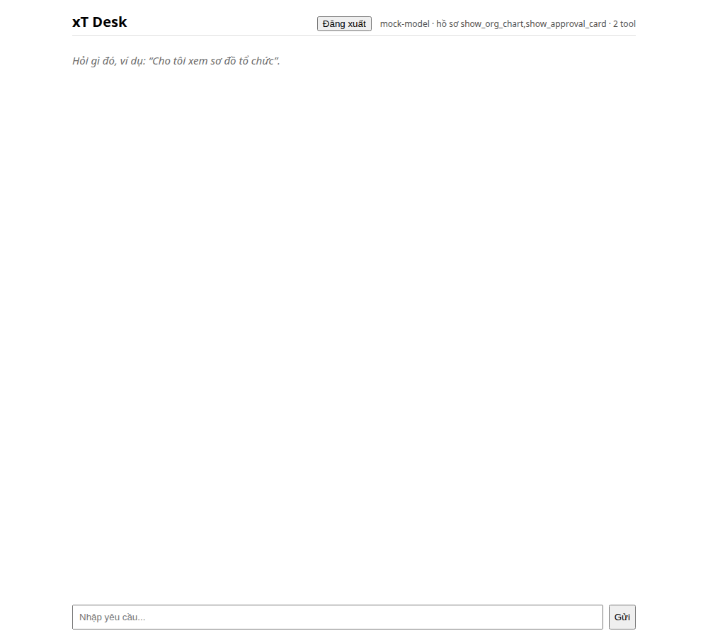
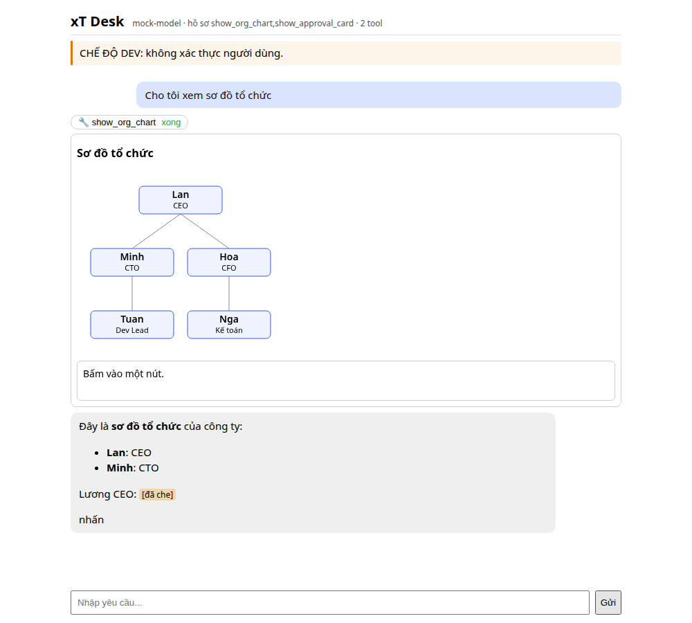
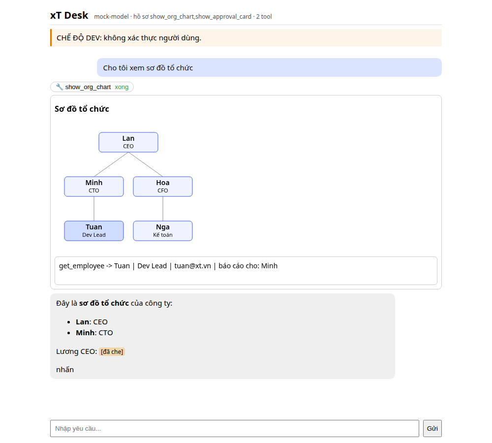
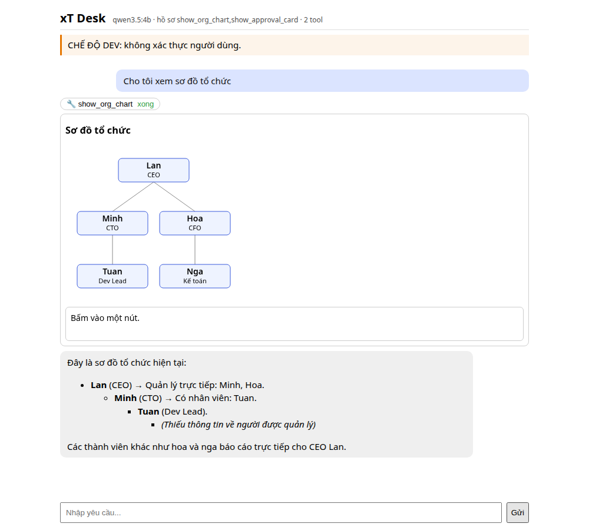

<!-- SPDX-License-Identifier: Apache-2.0 -->
<!-- SPDX-FileCopyrightText: 2026 xT contributors -->
# xT — Agent-native DX-OS

xT là một **DX-OS Open-Core** cho doanh nghiệp: lõi headless (SSO, API Gateway, dữ liệu, workflow) được lộ ra qua **MCP (Model Context Protocol)**, còn **agent AI (ChatGPT, Claude, LLM chạy local) chính là giao diện**. Bộ tool cố định, **nghiệp vụ là dữ liệu**: model và quy trình do agent đề xuất, con người duyệt rồi mới áp dụng. Không gắn với một ngành cụ thể.

> **English summary.** xT is an agent-native, open-source (Apache-2.0) digital-operations platform for the OLP 2026 Open Source Software contest. A headless Tier 1 (Keycloak SSO, APISIX gateway, PostgreSQL with row-level security plus a model engine, a SpiffWorkflow-based process engine and a PostgreSQL job worker) is exposed through MCP (19 model tools and 3 app-only tools; business logic as data). Tier 2 is *xT Desk*, a chat front end that renders MCP Apps inline. Tier 1 also exposes `/data` (PostgREST), `/files/v1` (SeaweedFS) and `/workflow/v1` (REST); Desk tokens are DPoP-bound by default. Earlier E0–E11 runs passed in both DPoP modes; their evidence limits are recorded in [verification](docs/verification-20261016.md). The latest [ChatGPT test report](docs/mcp-chatgpt-20261017.md) separates real host calls, Desk confirmations and independent server checks. Build from source with `uv`, Node (nvm), `make` and Docker Engine/Podman: see [INSTALL.md](INSTALL.md). Planned items are explicitly marked "dự kiến". Issues: GitHub Issues. Changes: [CHANGELOG.md](CHANGELOG.md).

**Trạng thái:** phiên bản `0.1.0.dev0`, đang phát triển. E0–E11 đã đạt 12/12 ở hai chế độ DPoP trong lượt trước; [báo cáo xác minh](docs/verification-20261016.md) ghi rõ nguồn bằng chứng. Trạng thái MCP mới nhất nằm ở [lượt ChatGPT ngày 17/10](docs/mcp-chatgpt-20261017.md). Chưa chứng nhận production hoặc DCR tự động trên các host.

## Ảnh chụp màn hình

| | |
|---|---|
|  |  |
| xT Desk: màn hình bắt đầu | MCP App (sơ đồ tổ chức) hiển thị inline trong chat |
|  |  |
| App gọi tool qua Desk | Chạy với LLM local (Ollama, qwen3.5:4b) |

## Kiến trúc: 3 tầng, 7 lớp, H-P-D-I

Chi tiết và lý do từng quyết định: [docs/architecture-v2.md](docs/architecture-v2.md) (§2).

**3 tầng (đề thi §2–§3)**

| Tầng | Nội dung trong xT |
|---|---|
| 1. Lõi dịch vụ số, headless (không UI) | 4 dịch vụ bắt buộc: **Identity/SSO** (Keycloak, `/auth`), **API Gateway** (APISIX), **Dữ liệu** (PostgreSQL 17 + RLS + model engine, PostgREST `/data`), **Workflow** (SpiffWorkflow + `xt-worker`, REST `/workflow/v1`), **Tệp** (SeaweedFS, `/files/v1`). Cả hai kênh MCP `/mcp` và REST dùng chung một bộ use case |
| 2. Ứng dụng minh họa có giao diện | **xT Desk** (React/Vite): chat với LLM, MCP Apps hiển thị inline, trang xác nhận `/desk/confirm`. Gói nghiệp vụ và skills nằm ở tầng này |
| 3. Ứng dụng của doanh nghiệp | Gói nghiệp vụ là dữ liệu (`packages/`), do cộng đồng/doanh nghiệp viết thêm |

**7 lớp công nghệ (đề thi §4, bảng tham chiếu; công nghệ thực chọn)**

| Lớp | xT chọn | Trạng thái |
|---|---|---|
| 1 Trải nghiệm | xT Desk, MCP Apps | Có (Desk); bot Telegram dự kiến |
| 2 Biên / an toàn thông tin | APISIX, Keycloak (OIDC, PKCE, DCR, TOTP step-up, DPoP), làn che PII + kênh `/pii/reveal` | Có (DPoP, PII reveal: đã có test tích hợp, `/pii/reveal` e2e PASS); ClamAV, OpenBao có trong profile `full`, tích hợp mức ứng dụng dự kiến |
| 3 Tác nghiệp | PostgreSQL 17, model engine (bảng thật, RLS, audit hash-chain), PostgREST | Có |
| 4 Quy trình / DevSecOps | SpiffWorkflow (BPMN 2.0), `xt-worker` (procrastinate), CI, cấu hình khai báo | Có |
| 5 Hội tụ / sổ cái | NATS JetStream, SeaweedFS, Parquet, chữ ký sự kiện | SeaweedFS: đã có test tích hợp (`/files/v1`), chờ e2e; NATS/Parquet/chữ ký sự kiện: dự kiến |
| 6 Phân tích / trí tuệ | Ollama + qwen3.5:4b (agent local), DuckDB | Ollama có; DuckDB dự kiến |
| 7 Giám sát / tìm kiếm | OpenTelemetry, `/metrics`, FTS/pgvector | Dự kiến |

**H-P-D-I (đề thi §1–§2).** Trục chính của ứng dụng minh họa: **P (Quy trình)**, e-Office: đề xuất–phê duyệt, giao việc có SLA; và **I (Trí tuệ)**: agent là giao diện, có quản trị quyền tự chủ L0–L3 và audit. Phụ: **H (Con người)** với danh tính cho cả người và agent, sơ đồ tổ chức; **D (Dữ liệu)** với bảng thật có ràng buộc, audit, lineage.

### Bản tích hợp xT + Studio + WareTrack: ánh xạ tới đường dẫn

Kế hoạch: [docs/plans/2026-10-17-unified-xt-studio-waretrack.md](docs/plans/2026-10-17-unified-xt-studio-waretrack.md). Chạy local: [docs/unified-local.md](docs/unified-local.md); vận hành: [docs/unified-ops.md](docs/unified-ops.md); quyền: [docs/unified-role-matrix.md](docs/unified-role-matrix.md).

| Khung | Phần tử | Đường dẫn |
|---|---|---|
| Tầng 1 (lõi headless) | SSO, gateway | `deploy/keycloak/`, `deploy/apisix/apisix.yaml.tmpl`, `src/xt/adapters/identity/` |
| | Dữ liệu, workflow, tệp | `src/xt/application/model_engine/`, `src/xt/application/process/`, `src/xt/adapters/http/workflow_api.py`, `src/xt/adapters/http/files_api.py`, `deploy/compose.yaml` |
| Tầng 2 (cổng doanh nghiệp) | Desk / shell | `desk/` |
| | Studio (không gian I) | `imports/dify-rea/`, cầu nối `src/xt/entrypoints/studio_http.py`, `studio_tools.py` |
| Tầng 3 (ngành) | WareTrack | `imports/waretrack-3d/` (giao diện), `packages/kho-hang/` (nghiệp vụ kho), `src/xt/application/warehouse/` |
| Lớp 1 Trải nghiệm | Web, MCP | `desk/`, `imports/dify-rea/src/web/`, `imports/waretrack-3d/src/`, `src/xt/adapters/mcp/` |
| Lớp 2 Biên và ATTT | Gateway, danh tính, IAM | `deploy/apisix/`, `src/xt/adapters/identity/`, `src/xt/application/iam/` |
| Lớp 3 Tác nghiệp | Model, phiếu, RLS | `src/xt/adapters/db/`, `packages/*/models/` |
| Lớp 4 Quy trình, DevSecOps | Workflow, worker, build | `packages/*/processes/`, `src/xt/adapters/workflow/`, `src/xt/entrypoints/worker.py`, `scripts/unified.mjs` |
| Lớp 5 Hội tụ, sổ cái | Audit, tệp, biến động kho | `src/xt/adapters/db/audit.py`, `src/xt/adapters/http/files_api.py`, `packages/kho-hang/models/stock_movement.json` |
| Lớp 6 Phân tích, trí tuệ | RAG, model, LLM relay | `imports/dify-rea/src/knowledge.ts`, `imports/dify-rea/src/models.ts`, `src/xt/entrypoints/desk_llm_http.py` |
| Lớp 7 Quản trị, giám sát | Audit, health, sao lưu | `src/xt/entrypoints/audit_cli.py`, `src/xt/adapters/mcp/http_app.py` (`/healthz`), `deploy/scripts/backup_unified.py` (sao lưu/khôi phục, xem [docs/unified-ops.md](docs/unified-ops.md)) |
| H (Con người) | Tổ chức, vòng đời nhân sự | `packages/nhan-su-vong-doi/`, `seed/` |
| P (Quy trình) | Đề xuất, phê duyệt, giao việc | `packages/de-xuat-phe-duyet/`, `packages/giao-viec-sla/`, `packages/kho-hang/processes/` |
| D (Dữ liệu) | Bảng, đọc dữ liệu | `src/xt/application/model_engine/`, `/data` ([docs/headless-data.md](docs/headless-data.md)); panel báo cáo D ở Desk đã có, nhưng `aggregate_records` ở lõi còn `unavailable` (D-UNI-AGG-1 chưa hiện thực) |
| I (Trí tuệ) | Studio, Desk, công cụ xT | `imports/dify-rea/`, `desk/`, `src/xt/entrypoints/studio_tools.py` |

Bảng chỉ trỏ vị trí mã; trạng thái từng phần xem bảng Tính năng bên dưới và [nhật ký thực thi](docs/plans/unified-execution.md). Chưa có mục nào của bản tích hợp được nghiệm thu đủ.

## Tính năng (chỉ liệt kê phần đã có mã và test)

**Cập nhật 17/10/2026:** [kiểm thử ChatGPT](docs/mcp-chatgpt-20261017.md) xác minh lại `create_task`, quyền đọc của trưởng bộ phận, metadata rút giấy và duyệt hai cấp bằng xác nhận Desk password/TOTP. Hai giấy gốc được sửa đúng thuộc tính phòng ban, vẫn approved và hiện revision 5; giấy B1/B2 mới dùng riêng cho lượt kiểm này. ChatGPT vẫn có lúc gắn “Suspicious Instruction” tại hộp xin quyền; ghi nhận riêng với kết quả máy chủ. [Báo cáo 16/10](docs/mcp-live-20261016.md) giữ nguyên lịch sử.

Số test (17/10/2026): `make check` **1.789 Python + 154 Vitest + 19 Playwright**, lint/mypy/import contracts/REUSE/SPDX đạt; 19 test tích hợp tập trung cho các bản sửa MCP đạt. Bộ integration đầy đủ ngày 16/10 đạt **548 passed, 2 deselected, 7 xfailed**; E0–E11 trước đó đạt **12/12 ở cả hai chế độ DPoP**. Không chạy lại toàn bộ E2E trong lượt ChatGPT này. Các cột mức kiểm bên dưới mô tả bằng chứng theo thành phần và có ghi chú lịch sử; xem hai báo cáo trên để biết lượt chạy và giới hạn chính xác.

| Tính năng | Mô tả | Mức kiểm | Tài liệu |
|---|---|---|---|
| MCP server | `xt serve` (Streamable HTTP, stdio): catalog 19 model tool + 3 app-only, mô tả dưới dạng dữ liệu (ToolContract), hồ sơ `core-10` và `full`; idempotency, mức tự chủ L0-L3, xác nhận hai pha. `notify` có xác nhận và inbox nội bộ; kênh ngoài chưa được chứng nhận | E2/E3; protocol SDK và ChatGPT theo báo cáo mới nhất | [mcp-server.md](docs/mcp-server.md), [tool-contracts-v1.md](docs/tool-contracts-v1.md), [notifications.md](docs/notifications.md) |
| Danh tính + DPoP | Token Keycloak (JWKS, `iss`, `aud`, `azp`), PRM (RFC 9728), step-up OTP, biên nhận Ed25519 dùng một lần, allowlist DCR; DPoP (RFC 9449) cho Desk bật mặc định (`XT_DPOP_REQUIRED=true`), cache jti dùng chung trên Postgres | e2e (E2); DPoP: tích hợp, chờ e2e | [identity.md](docs/identity.md), [audit-dpop.md](docs/audit-dpop.md) |
| Phân quyền (IAM) | Policy JSON: Deny > Allow, ranh giới tenant, SoD (cả trigger tầng DB), ủy quyền cho agent, `explain`, quyền theo vai trò công việc | e2e (E10 một phần); trigger SoD: tích hợp, chờ e2e | [iam.md](docs/iam.md) |
| Model engine | Spec JSON -> bảng PostgreSQL thật; planner SAFE/RISKY/DESTRUCTIVE, schema và RLS FORCE riêng từng tenant, audit hash-chain (kể cả `xt_meta.*`) + checkpoint Ed25519, CRUD tổng quát; agent đề xuất, người duyệt, worker áp pha 1+2 | e2e (E6, E11) | [model-engine.md](docs/model-engine.md) |
| Process engine | ProcessSpec JSON -> BPMN 2.0 (có sơ đồ), phê duyệt đa cấp, SLA, leo thang, song song, timer, SoD theo bước; `start_process`; bước người hoàn thành qua `transition_record` (`complete_via`) | tích hợp, chờ e2e; leo thang SLA: e2e FAIL ở lần chạy cũ (212 s > 135 s) | [process-engine.md](docs/process-engine.md) |
| Hàng đợi / timer | `xt worker` trên PostgreSQL: enqueue cùng transaction, lịch IANA, recover worker chết, job role quyền tối thiểu | tích hợp | [worker-queue.md](docs/worker-queue.md) |
| Tầng 1 headless | `/data` (PostgREST, `aud=xt-data`), `/workflow/v1` (REST, OpenAPI 3.1, `aud=xt-workflow`), `/files/v1` (SeaweedFS, `aud=xt-files`) | `/data`: e2e (E4); `/workflow/v1`: e2e một phần; `/files/v1`: tích hợp, chờ e2e | [headless-data.md](docs/headless-data.md), [workflow-api.md](docs/workflow-api.md), [files-api.md](docs/files-api.md) |
| Kênh PII | Client cloud chỉ thấy `[PII:token]`; người trong Desk xem giá trị thật qua `/pii/reveal` (vé một lần gắn khóa DPoP), audit `egress` | e2e (E5) | [audit-pii-reveal.md](docs/audit-pii-reveal.md), [desk.md](docs/desk.md) |
| xT Desk + 3 MCP App | Chat tiếng Việt, OIDC PKCE + DPoP, MCP Apps (`orgchart`, `approval-card`, `record-table`) trong sandbox khác origin, giới hạn tốc độ lời gọi App | App trong Desk: e2e Desk trên server thật; Desk container + LLM local: tích hợp, chờ e2e (E1, E9) | [desk.md](docs/desk.md), [e2e-desk-keycloak.md](docs/e2e-desk-keycloak.md) |
| Gói nghiệp vụ + seed | 3 gói chính `de-xuat-phe-duyet`, `giao-viec-sla`, `nhan-su-vong-doi` (dữ liệu JSON) + gói quản trị mô hình, `kenh-pii`, `tep-dinh-kem`, `thong-bao`; 4 skill agent; seed Bình Minh + Hoa Mai, ánh xạ vai trò (`mapping.json`) | `de-xuat-phe-duyet`: e2e; hai gói còn lại: tích hợp, chờ e2e | `packages/*/README.md`, `seed/` |
| Triển khai | Docker Compose, profile `minimal`/`full`/`public`, container non-root, `read_only`, `cap_drop ALL`, APISIX rate-limit | smoke bảo mật 46/47 ở lần chạy e2e (đã sửa mục còn lại, chờ chạy lại) | [deploy.md](docs/deploy.md) |
| Eval agent | 73 scenario; qwen3.5:4b core-10 x3: 62% (không skill) / 59% (có skill), đo trên **mock** | mock; E1 trên xT thật chưa PASS | [evals.md](docs/evals.md) |
| Kiểm như giám khảo / e2e | `make verify-clean` (clone HEAD -> setup, check, release, kiểm tarball); `make e2e` (E0-E11, 2 tenant, TOTP) | E0–E11 12/12 hai chế độ DPoP; giới hạn log trong báo cáo xác minh | [INSTALL.md](INSTALL.md), [e2e.md](docs/e2e.md) |

**Audit bảo mật:** 13 báo cáo [docs/audit-*.md](docs/gap-review.md) (kiểm thử nội bộ bằng agent độc lập, không phải bên thứ ba), 144 phát hiện đánh số, 141 đã sửa kèm test hồi quy; một số bản sửa cuối chưa được tester xác nhận (xem mục 0.3 của [docs/gap-review.md](docs/gap-review.md)).

**Dự kiến (chưa có mã hoặc chưa chạy thật):** `notify` hoàn chỉnh (kênh Telegram, leo thang SLA qua Notifier) và 2 tool còn lại để đủ 21 (v1.0), `aggregate_records` (còn trả `capability_unavailable`), kiểm dịch ClamAV và két sắt OpenBao ở mức ứng dụng, luồng NATS/Parquet/DuckDB, `xt backup`/`xt restore`, remote công khai + tag phiên bản, DCR tự động tương thích Claude/ChatGPT (smoke bằng client test cấu hình sẵn đã chạy, xem báo cáo kiểm thử).

## Bắt đầu nhanh

Cần Docker Engine (hoặc Podman), `uv`, Node (nvm), `make`. Từ bản sạch Ubuntu 24.04: xem [INSTALL.md](INSTALL.md).

```sh
make setup            # uv sync
make check            # lint, mypy, import-linter, reuse lint, pytest (+ Desk nếu đã desk-setup)
make desk-setup && make desk-build   # Desk (cấu hình trước khi dịch: desk/.env)
make up-minimal && make provision-realm   # stack tối thiểu bằng Docker Engine
make release          # dist/xt-<version>.tar.gz + SBOM + SHA256SUMS
```

## Giấy phép và mục đích giấy phép

xT dùng **Apache-2.0** (OSI-approved). **Mục đích:** cho phép sinh viên, cộng đồng và doanh nghiệp dùng, sửa, phân phối lại và đóng góp, kể cả trong sản phẩm thương mại, với điều khoản cấp quyền sáng chế rõ ràng và yêu cầu giữ thông báo bản quyền; đồng thời tương thích với các phụ thuộc MIT/BSD/Apache và với thư viện LGPL chỉ được import không sửa (SpiffWorkflow, psycopg). Mỗi tệp mã có header `SPDX-License-Identifier: Apache-2.0` (kiểm bằng `reuse lint` và `scripts/check_spdx.sh`).

- Toàn văn: [LICENSE](LICENSE), thông báo: [NOTICE](NOTICE).
- Chiến lược và ma trận tương thích: [docs/LICENSING.md](docs/LICENSING.md).
- Danh mục thư viện, giấy phép, nguồn: [THIRD_PARTY_NOTICES.md](THIRD_PARTY_NOTICES.md). Không vendor mã của dự án khác; SBOM CycloneDX đi kèm mỗi bản phát hành.

## Tài liệu

[INSTALL.md](INSTALL.md) · [docs/dev-setup.md](docs/dev-setup.md) · [docs/architecture-v2.md](docs/architecture-v2.md) · [docs/deploy.md](docs/deploy.md) · [docs/decisions.md](docs/decisions.md) · [docs/glossary.md](docs/glossary.md) · [SECURITY.md](SECURITY.md)

## Bug tracker, changelog, đóng góp

- **Bug tracker:** GitHub Issues của repo (mẫu **Báo lỗi** và **Đề xuất tính năng** trong `.github/ISSUE_TEMPLATE/`). Không đăng bí mật hay dữ liệu cá nhân; lỗ hổng bảo mật báo theo [SECURITY.md](SECURITY.md).
- **Changelog:** [CHANGELOG.md](CHANGELOG.md) (Keep a Changelog).
- **Đóng góp:** [CONTRIBUTING.md](CONTRIBUTING.md) (SPDX, kiểm tra, DCO sign-off), [CODE_OF_CONDUCT.md](CODE_OF_CONDUCT.md), mẫu PR trong `.github/`.
