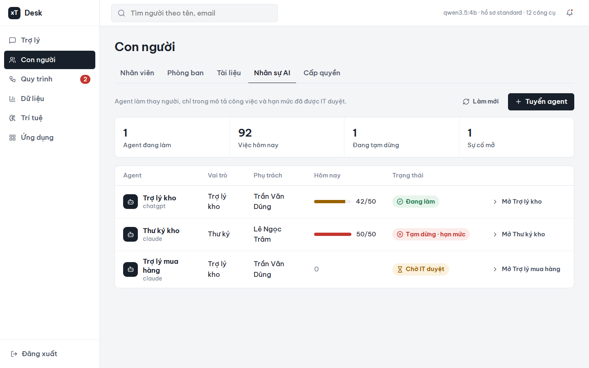
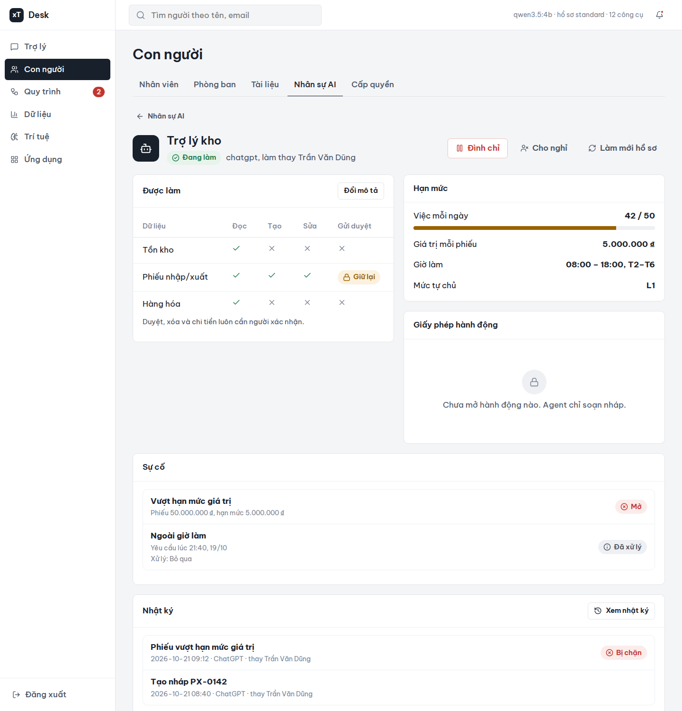
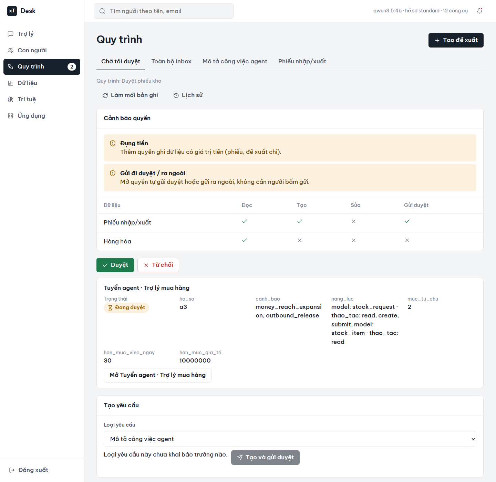
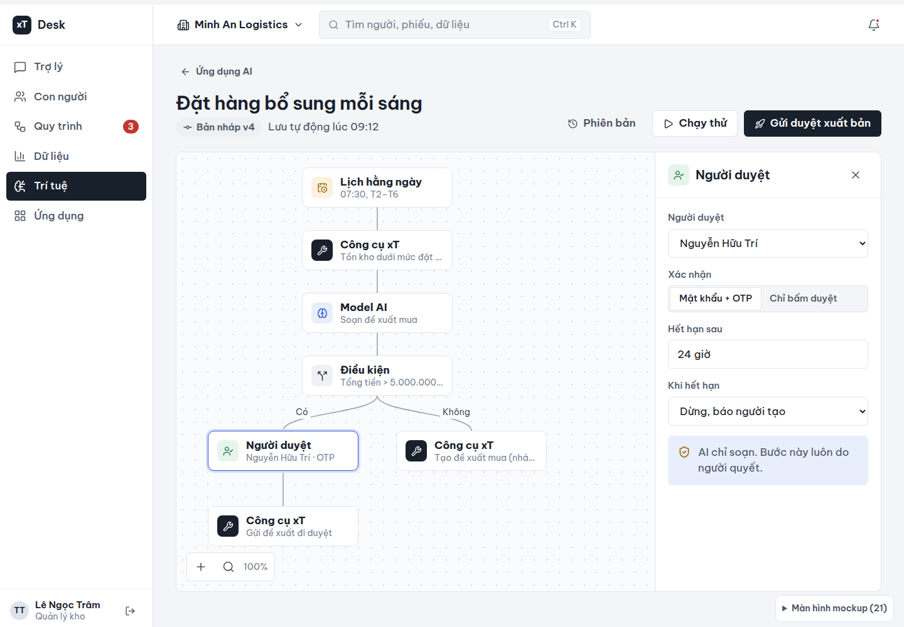

<!-- SPDX-License-Identifier: Apache-2.0 -->
<!-- SPDX-FileCopyrightText: 2026 xT contributors -->
# xT — phòng nhân sự và nội quy cho AI trong doanh nghiệp

[](docs/media/xt-gioi-thieu.mp4)

▶ **[Xem video giới thiệu (2 phút)](docs/media/xt-gioi-thieu.mp4)**

xT là nền tảng **nguồn mở (Apache-2.0)** giúp doanh nghiệp **giao việc cho AI agent một cách an toàn**. Nhân viên nhắn ChatGPT, Claude hoặc AI chạy tại chỗ; AI làm việc thật trên dữ liệu công ty, nhưng chỉ trong phạm vi được giao, việc quan trọng luôn có người duyệt, và mọi hành động được ghi lại không sửa lén được.

Dự án dự thi **OLP Phần mềm nguồn mở 2026**, xây theo khung kiến trúc **DX-OS** của đề thi.

> **Trạng thái (26/10/2026): tạm dừng.** Bản demo công khai đã tắt. Mã nguồn, tài liệu và lịch sử đầy đủ ở repo này.

## Vấn đề

- AI đã làm được việc thật, nhưng doanh nghiệp sợ AI tự ý sửa dữ liệu, làm lộ thông tin, và không biết ai chịu trách nhiệm.
- Phần lớn dự án AI agent dừng ở mức thử nghiệm vì thiếu **danh tính, phân quyền và truy vết**.
- **Luật Trí tuệ nhân tạo (134/2025/QH15)** có hiệu lực từ 01/3/2026: doanh nghiệp cần chứng minh được AI của mình làm gì và ai kiểm soát.

## Ý tưởng

AI được quản lý **như một nhân viên**:

| | Với nhân viên AI trong xT |
|---|---|
| **Tuyển** | Đăng ký agent (ChatGPT, Claude, AI local), có người phụ trách, IT duyệt |
| **Mô tả công việc** | Được đọc/ghi dữ liệu nào; nâng quyền rủi ro thì hệ thống tự cảnh báo |
| **Hạn mức** | Số việc mỗi ngày, giá trị tối đa mỗi phiếu, giờ làm |
| **Duyệt** | Duyệt, chi tiền, gửi đi luôn cần **người thật** xác nhận; AI không tự duyệt được |
| **Đình chỉ / cho nghỉ** | Một nút, có hiệu lực ngay ở lượt kế tiếp |
| **Nhật ký** | Chuỗi hash + chữ ký số Ed25519: agent nào, thay ai, làm gì, ai duyệt |

Ba lời hứa: **không vượt quyền · không tự quyết · không mất dấu.**

## Luồng hoạt động

```
Nhân viên nhắn ChatGPT ─► xT: Ai đang gọi? ─► Được làm không? ─► Cần ai duyệt? ─► Ghi dữ liệu + nhật ký ký số
                               (SSO, OAuth)    (quyền + JD agent,     (người thật,
                                                hạn mức)               mật khẩu/OTP)
```

AI thử tự duyệt, làm ngoài mô tả công việc, vượt hạn mức hoặc đang bị đình chỉ → **bị chặn**, có lý do rõ ràng và được ghi nhật ký.

## Kiến trúc theo đề thi DX-OS

### 3 tầng

| Tầng | Trong xT |
|---|---|
| **1. Nền tảng Dịch vụ Lõi số** (headless) | Lõi không giao diện, lộ ra qua API và **MCP** cho ChatGPT/Claude |
| **2. Không gian Năng lực số (H-P-D-I)** | Web **Desk** và **Studio** |
| **3. Nền tảng Kinh doanh số** (cắm-rút) | Gói nghiệp vụ bật/tắt không mất dữ liệu: Kho hàng (có sơ đồ 3D), Khách hàng (CRM), Chấm công, Tài sản, Đề xuất & phê duyệt, Vòng đời nhân sự, **Nhân sự AI** |

### 7 lớp dịch vụ lõi (Tầng 1)

| # | Lớp theo đề | Thành phần nguồn mở trong xT |
|---|---|---|
| 1 | Định danh, Bảo mật, An toàn thông tin | Keycloak (SSO, OTP), OpenBao, ClamAV, chữ ký Ed25519 |
| 2 | Đa thuê ước, Biên mạng, Cá thể hóa | Apache APISIX (cổng API, DPoP), che dữ liệu cá nhân, RLS tách từng công ty |
| 3 | Dữ liệu có cấu trúc và Giao dịch | PostgreSQL 17, PostgREST, lịch sử thay đổi |
| 4 | Dữ liệu phi cấu trúc và Hồ sơ | SeaweedFS (chuẩn S3) |
| 5 | Quy trình và Tự động hóa | SpiffWorkflow (BPMN), Procrastinate, Studio workflow |
| 6 | Vận hành, Giám sát và Kiểm toán | Nhật ký hash-chain + checkpoint ký số, sao lưu/khôi phục, Docker Compose |
| 7 | Truyền thông và Giao vận dữ liệu | NATS, thông báo, MCP (Streamable HTTP) |

### H-P-D-I trên Desk

| Không gian | Mục trên Desk |
|---|---|
| **[H] Con người số** | Con người: nhân viên, sơ đồ tổ chức (người + agent), cấp quyền, **Nhân sự AI** |
| **[P] Quy trình số** | Quy trình: hộp chờ duyệt, đề xuất, xác nhận bằng mật khẩu/OTP |
| **[D] Dữ liệu số** | Dữ liệu: báo cáo bấm vào ra chứng từ gốc, bản ghi, nhật ký |
| **[I] Trí tuệ số** | Trí tuệ: Studio + **Nhân sự AI** — đúng mục "Cổng quản trị và giám sát các tác tử AI" của đề |

## Thành phần chính

- **Lõi xT** (`src/xt/`, Python): bộ công cụ MCP cố định, "nghiệp vụ là dữ liệu" (gói = model + quy trình + quyền), kiểm quyền, cổng AgentHR, nhật ký ký số.
- **Nhân sự AI / AgentHR** (`packages/nhan-su-ai/`, `src/xt/application/agenthr/`): hồ sơ agent, mô tả công việc, hạn mức, giấy phép hành động, sự cố, đình chỉ.
- **Desk** (`desk/`, React): giao diện 6 khu vực Trợ lý · Con người · Quy trình · Dữ liệu · Trí tuệ · Ứng dụng.
- **Studio** (`imports/dify-rea/`, TypeScript): dựng quy trình AI kiểu Dify — khối Công cụ xT, Rẽ nhánh, AI phân loại, AI trích thông tin, Xử lý danh sách, Lặp, Vòng lặp, **Người duyệt**, hẹn giờ, nhật ký chạy. Viết mới từ phân tích hành vi, không chép mã Dify.
- **Gói nghiệp vụ** (`packages/`): 12 gói JSON, cài bằng `xt pack install` (xem kế hoạch rồi xác nhận).

## Hình ảnh

| | |
|---|---|
|  |  |
| Nhân sự AI: danh sách agent, hạn mức hôm nay | Hồ sơ agent: được làm gì, hạn mức, đình chỉ |
|  |  |
| Duyệt tuyển agent kèm cảnh báo nâng quyền | Studio: workflow có khối Người duyệt |

Mockup toàn bộ giao diện: [docs/mockups/desk/index.html](docs/mockups/desk/index.html).

## Chạy thử

Cần Ubuntu 24.04, `uv`, Node ≥ 24, `make`, Docker Engine. Hướng dẫn đầy đủ: [INSTALL.md](INSTALL.md).

```sh
make setup && make check          # cài và kiểm (lint, test)
make up-minimal && make provision-realm
make desk-setup && make desk-build
```

Cài một gói nghiệp vụ (hai người khác nhau đề xuất và duyệt):

```sh
uv run xt pack install --tenant <tenant> packages/nhan-su-ai --proposed-by person:<A> --approved-by person:<B>
# xem kế hoạch, rồi chạy lại với --confirm <digest>
```

Tài khoản demo mỗi cấp một người: [docs/demo-accounts.md](docs/demo-accounts.md).

## Tài liệu

| | |
|---|---|
| Kế hoạch AgentHR | [docs/plans/2026-10-20-agenthr.md](docs/plans/2026-10-20-agenthr.md) |
| Quyết định thiết kế | [docs/decisions.md](docs/decisions.md) |
| Kiến trúc | [docs/architecture-v2.md](docs/architecture-v2.md) |
| Bộ công cụ MCP | [docs/mcp-server.md](docs/mcp-server.md), [docs/tool-contracts-v1.md](docs/tool-contracts-v1.md) |
| Danh tính, phân quyền | [docs/identity.md](docs/identity.md), [docs/iam.md](docs/iam.md) |
| Desk | [docs/desk.md](docs/desk.md) |
| Đối chiếu Studio với Dify | [imports/dify-rea/docs/dify-gap-20261020.md](imports/dify-rea/docs/dify-gap-20261020.md) |
| Kịch bản video | [docs/demo/kich-ban-video-xt.md](docs/demo/kich-ban-video-xt.md) |
| Triển khai | [docs/deploy.md](docs/deploy.md) |

## Giấy phép

**Apache-2.0** — [LICENSE](LICENSE), [NOTICE](NOTICE). Chỉ dùng phụ thuộc có giấy phép OSI; danh mục: [THIRD_PARTY_NOTICES.md](THIRD_PARTY_NOTICES.md). Font Be Vietnam Pro (OFL-1.1), icon Lucide (ISC). Mọi tệp có header SPDX, kiểm bằng `reuse lint`.

Báo lỗi: [GitHub Issues](https://github.com/chinhanxt/xT-MCP/issues) · Thay đổi: [CHANGELOG.md](CHANGELOG.md) · Đóng góp: [CONTRIBUTING.md](CONTRIBUTING.md) · Bảo mật: [SECURITY.md](SECURITY.md)
