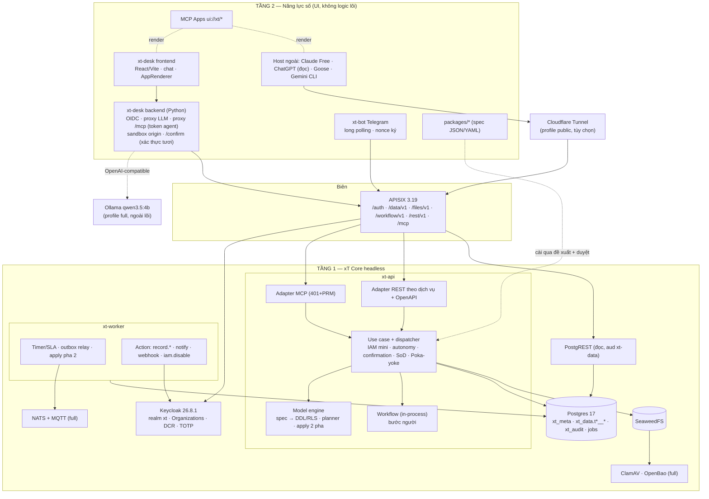

<!-- SPDX-License-Identifier: Apache-2.0 -->
# xT — Kiến trúc v2

- Phiên bản tài liệu: `arch-v2.0` · Ngày: 15/10/2026 · Vai trò viết: ARCHITECT.
- Tài liệu này **thay thế** `architecture-v1.md`.
- Debate với critic được ghi ở `architecture-debate.md` (30 mục, mỗi mục có phán quyết).
- Mỗi quyết định ghi theo khuôn: **Quyết định → Lý do → Bằng chứng → Phương án bị loại**.
- Chưa chạy thật thì ghi **[chưa kiểm chứng]**.

### Viết tắt nguồn (tất cả nằm trong `research/`, trừ khi ghi khác)

| Mã | Tệp | Mã | Tệp |
|---|---|---|---|
| DE | `de_thi_OLP2026.txt` | CL | `olp-checklist.md` |
| PP | `pain-points.md` | RT | `red-team.md` |
| BB | `building-blocks.md` | VR | `verified-repos.md` |
| RA | `repos-auth-ui-audit.md` | REA | `rea-lessons.md` |
| SK | `sklite-lessons.md` | TC | `tool-contracts-draft.md` |
| TCC | `tool-contracts-critique.md` | SAUTH | `spike-mcp-auth.md` |
| SAPPS | `spike-mcp-apps.md` | SSPIFF | `spike-spiffworkflow.md` |
| SFR | `spike-frappe.md` | CR | `connector-requirements.md` |
| VS | `verification-spikes.md` | SME | `spike-model-engine.md` |
| SIAM | `spike-iam.md` | SLLM | `spike-local-llm.md` |
| SDESK | `spike-desk.md` | ST | `docs/demo-storyboard-v0.md` |
| CRIT | `docs/architecture-v1-critique.md` | TCV1 | `docs/tool-contracts-v1.md` **[đang viết song song, chưa có]** |

### Ràng buộc từ chủ dự án (chốt 15/10/2026)

- xT Desk **có chat + LLM local** ở v1.0.
- Tài khoản demo:
  - ChatGPT Plus/Pro: connector có thể chỉ đọc (CR §1).
  - Gemini Pro.
  - Claude Free: tối đa 1 custom connector.
- Repo: commit local, push sau.
- Hạ tầng công khai: **Cloudflare Tunnel từ máy này** (RTX 3050 6 GB, RAM 15 GB, SLLM).

---

## 0. Mười hai quyết định chốt

| # | Quyết định | Bị loại | Nguồn |
|---|---|---|---|
| D1 | **Catalog tool cố định**, sinh từ ToolContract. Số lượng và tên do TCV1 chốt. Kiến trúc chỉ bắt buộc 6 năng lực và 3 bất biến (§1.3) | Tool sinh theo model; `execute(mode)`; Code Mode | TC §1, TCC §C/E, CRIT 2 |
| D2 | **Không Code Mode** trước v1.0. Không chạy code do agent gửi | Sandbox V8/WASM; `exec` Python | RT §0.2, SK §7, SSPIFF §4 |
| D3 | **SDK chính thức `mcp` 2.3.0** (MIT), bọc sau adapter mỏng | FastMCP 4.1 | SAUTH §3, VS B |
| D4 | **SpiffWorkflow 3.2.0** ở `adapters/workflow`. Bước người chạy **in-process trong `xt-api`**. Timer, service task, outbox chạy trong **`xt-worker`**. Cùng một image | Container "dịch vụ workflow" riêng; Flowable (phương án B qua port `ProcessEngine`) | SSPIFF, CRIT 4 |
| D5 | **Postgres 17**, RLS FORCE, tách role: bootstrap superuser, migrator BYPASSRLS, `xt_app` NOBYPASSRLS | Schema/DB-per-tenant | SME §3.2, SK §4 |
| D6 | **Bảng vật lý theo model**, namespace theo tenant `xt_data.t<seq>__<model>`. Planner diff theo id ổn định. Apply 2 pha | Bảng chung JSONB (v1); Frappe DocType | SME (chạy thật), BB L53, CRIT 1 |
| D7 | **Tầng 2 = xT Desk** (React/Vite + `@mcp-ui/client` + chat qwen3.5:4b local) là **kênh demo chính**. Cộng thêm MCP Apps và Telegram | Chỉ chat trong host đóng; frontend nghiệp vụ truyền thống; Chainlit (dự phòng) | SDESK, SLLM, RT Q1 |
| D8 | **Xác nhận của người chỉ đi qua 2 kênh.** (1) `/confirm` của Desk, xác thực tươi (`max_age=0` + TOTP; L3/vượt ngưỡng thêm `prompt=login` + `acr`). (2) Nút Telegram có nonce do xT ký. Không có CLI. Có SoD ở DB | CLI TTY; Device grant; link bearer; tin nút MCP App ở host ngoài | CRIT 16–19, TCC F1 |
| D9 | **Một realm `xt`**. Tenant = Organization, 1 user = 1 org. Scope `mcp-xt` optional (fallback: default + denylist `azp`). PostgREST dùng `aud` riêng. **xT giữ tổ chức/vai trò, Keycloak chỉ xác thực + MFA** | Realm-per-tenant; nhóm nghiệp vụ trong Keycloak | CR §1, VS #1, CRIT 5/14/22 |
| D10 | **Compose 3 profile.** `minimal` (gồm Desk, không LLM, mục tiêu < 4 GB). `full` (LLM, NATS, ClamAV, OpenBao). `public` (Cloudflare Tunnel hoặc TLS tự quản) | Redpanda, Kafka; NATS bắt buộc | RT Q8, CRIT 11/13 |
| D11 | **IAM: evaluator mini + ngôn ngữ policy đóng** (spike-iam), condition `eq/ne/le/ge/in` trên thuộc tính whitelist. pycasbin làm **oracle trong CI** | pycasbin runtime (chậm ~60×, không giải thích được); vakt (jsonpickle thực thi code) | SIAM §6–7 |
| D12 | **APISIX lộ 4 dịch vụ thành 4 namespace riêng** (`/auth`, `/data/v1` + `/files/v1`, `/workflow/v1`, `/rest/v1` + `/mcp`). `/mcp` đi thẳng (TLS + rate-limit IP); `xt-api` tự trả 401 + PRM | JWT ở gateway cho `/mcp` | CR L18, CRIT 6/27 |

---

## 1. Định nghĩa sản phẩm

### 1.1. Một đoạn

xT là **lõi vận hành số headless, đa năng, tự host được** cho doanh nghiệp Việt Nam 10–200 người.

- **Lõi Tầng 1** gồm: SSO (Keycloak), API Gateway (APISIX), dữ liệu có cấu trúc (Postgres + RLS + model engine + PostgREST), dữ liệu phi cấu trúc (SeaweedFS) và workflow BPMN (SpiffWorkflow).
- **Ba kênh dùng chung một hợp đồng:** MCP, REST/OpenAPI theo 4 namespace dịch vụ, và API đọc tự sinh.
- **Cách người dùng làm việc:**
  - Qua **xT Desk**: trình duyệt, chat với LLM chạy trong máy chủ doanh nghiệp, MCP Apps hiển thị ngay trong luồng chat.
  - Qua bất kỳ host MCP nào (Claude, ChatGPT, Goose, Gemini CLI).
  - Qua nút Telegram.
- **Nghiệp vụ là dữ liệu.** Model, quy trình, ngưỡng duyệt và SLA đều là định nghĩa có phiên bản. Agent đề xuất, con người xem kế hoạch thay đổi rồi duyệt, server áp dụng nguyên tử vào **bảng thật**.
- **Agent là chủ thể bảo mật hạng nhất.** Mỗi agent có danh tính riêng và mức tự chủ L0–L3. Agent không bao giờ tự duyệt được, và mọi hành động đều đi vào audit hash-chain.
- **Lõi không gọi LLM.** LLM chỉ nằm ở Desk (Tầng 2) hoặc ở host ngoài.

### 1.2. Personas

| Persona | Việc chính | Kênh chính | PP |
|---|---|---|---|
| Nhân viên | Xin tạm ứng, nghỉ phép, nhận việc | Desk chat + form; Telegram | PP1, PP2, PP6 |
| Quản lý/người duyệt | Duyệt, giao việc, theo dõi SLA | Telegram 1 chạm; `/confirm`; thẻ duyệt | PP1, PP2 |
| Kế toán / HR | Kiểm chứng từ, on/offboarding | Desk | PP6, PP7 |
| Giám đốc | Bản tin, duyệt ngưỡng cao (MFA) | Desk, Telegram | PP5, PP13 |
| Quản trị nghiệp vụ | Mô tả nghiệp vụ bằng lời → duyệt kế hoạch thay đổi model/process | Desk + app diff | PP12, PP14 |
| Vận hành IT | Cài, sao lưu, cấp/thu hồi agent | `xt` CLI (chỉ vận hành), compose | PP13, PP14 |
| **Agent** | Gọi tool trong trần tự chủ | MCP | — |
| Nhà tích hợp | REST theo dịch vụ, PostgREST | OpenAPI | PP3 |
| *Ban giám khảo* | Build từ nguồn, chấm PoF | README, `make`, CI | CL §2 |

### 1.3. "Bộ tool cố định, nghiệp vụ là dữ liệu"

- **Quyết định (D1):** `tools/list` là một catalog cố định, sinh từ ToolContract.
  - **Số lượng và tên tool do TCV1 chốt.** Lúc viết, các đề xuất đang có: CRIT 2 đề 16; TCC §E đề 17 cho v0.1 và 22 cho v1.0.
  - Kiến trúc chấp nhận mọi catalog thỏa 3 điều kiện dưới đây, và ≤ 22 tool ở v1.0.
- **Sáu năng lực bắt buộc** (từ các blocker F1–F5 của TCC):

| # | Năng lực | Lý do |
|---|---|---|
| 1 | Luồng confirmation: lỗi trả `confirm_url` (chỉ là locator) + `confirmation_ref` ở trạng thái pending + continuation để gọi lại | TCC F1 |
| 2 | Chuyển trạng thái Record theo state machine của model | TCC F2 |
| 3 | Upload file (văn bản nhỏ inline, hoặc URL tải lên một lần) và đọc text đã trích | TCC F3 |
| 4 | Tổng hợp số liệu phía server, có lineage | TCC F4 |
| 5 | Tìm xuyên model (gồm danh bạ actor) và truy vấn đặt tên (`views`) | TCC F11, CRIT 26 |
| 6 | Submit/withdraw đơn của chính người được đại diện ở **L1** | TCC F5 |

- **Ba bất biến:**
  1. Catalog không đổi theo dữ liệu hay đăng nhập. Chỉ đổi theo version contract.
  2. Không Code Mode, không `execute`.
  3. Không tool app-only cho thao tác ghi. MCP Apps dùng tool public; confirmation đi theo D8.
- **Nguyên tắc contract mà kiến trúc dựa vào** (chi tiết thuộc TCV1):
  - Input đóng, output mở (TCC F14).
  - Phân trang bằng cursor (F15).
  - Một tên tham số gate duy nhất `confirmation_ref` (F16).
  - `destructiveHint` chỉ khi có thể mất dữ liệu hoặc chạy code ngoài (F6).
  - Dữ liệu doanh nghiệp đặt dưới `data` có `untrusted:true` trong `structuredContent` (F10).
  - Mọi lỗi/số liệu có `explain_ref` (F24).
- **Hồ sơ tool cho model nhỏ:** Desk chỉ đưa cho qwen3.5:4b một tập con cỡ 8 tool (TCC §E "core-8"), lọc phía client. Server vẫn quảng bá catalog đầy đủ theo REA (SLLM L89, TCC F27).

### 1.4. Workflow theo phiên bản

PP §3: 8 workflow quy về 3 động cơ là Request/Decision, Task/SLA và Record lifecycle. Mỗi workflow sau động cơ chỉ là **gói dữ liệu**.

| Mốc | Workflow | Gói | Điều kiện kiểm chứng |
|---|---|---|---|
| v0.1 | **W1** đề xuất–duyệt tuần tự + SLA (mẫu Tạm ứng) | `packages/office` | ST S1, S2 |
| v0.2 | W1 có trả lại, song song, `manager_of`; **W2** giao việc + SLA + định kỳ | `office` | ST S2 |
| v0.3 | **W3** on/offboarding; **W4** thu–chi (Ledger); lát mỏng W8 | `hr`, `finance` | ST S3, S4 |
| v1.0 | **W7** Helpdesk và **W5** CRM **chỉ bằng YAML**; W6 rút gọn (mẫu → PDF → ký Ed25519); W8 bản tin có lineage; gói Thiết bị (IT/OT) | `helpdesk`, `crm`, `docs`, `equipment` | CI chứng minh 2 gói đầu không có code Python mới (CRIT 24) |

---

## 2. Ánh xạ vào đề thi

### 2.1. Tầng 1: 4 dịch vụ bắt buộc, mỗi dịch vụ có endpoint riêng (D12)

| Dịch vụ | Thành phần | Namespace qua APISIX | Bằng chứng đã chạy | Cách giám khảo kiểm |
|---|---|---|---|---|
| Identity/SSO | Keycloak 26.8.1: OIDC, PKCE S256, DCR, MFA TOTP | `/auth` (realm `xt`) | SAUTH §6, VS B | Đăng nhập Desk; `xt doctor --auth` |
| API Gateway | APISIX 3.19 standalone YAML | toàn bộ | BB §E (SSE qua APISIX **[chưa kiểm chứng]**) | `curl` `/rest/v1` không token → 401 ở gateway |
| Dữ liệu | Postgres 17 + RLS + model engine (bảng thật) + PostgREST đọc; SeaweedFS (S3) có quét | `/data/v1`, `/files/v1` | SME §4, BB §F | `curl /data/v1/<model>` theo tenant |
| Workflow | SpiffWorkflow + `xt-worker` | `/workflow/v1` (definitions có BPMN XML + DI, instances, tasks, complete) | SSPIFF, VS A | Tải BPMN mở được trong Camunda Modeler; `docs/headless-demo.sh` chạy W1 không dùng MCP |

`/rest/v1/tools/{name}` và `/mcp` là hai kênh của cùng các use case. Route REST theo tài nguyên được **khai trong ToolContract** (`rest: {service, method, path}`), nên vẫn một nguồn sự thật. OpenAPI 3.1 chia tag theo 4 dịch vụ (CRIT 27).

**Ranh giới tầng.**
- Tầng 1, không UI: `xt-api`, `xt-worker`, Keycloak, APISIX, Postgres, PostgREST, SeaweedFS.
- Tầng 2: `xt-desk` (gồm `/confirm`), `xt-bot`, MCP Apps, gói nghiệp vụ, skills.

### 2.2. Tầng 1: hạng mục tùy chọn, phủ tối thiểu (đã cắt theo CRIT 11)

| Hạng mục (DE §2) | Phủ | Profile | Mốc |
|---|---|---|---|
| MFA, step-up | TOTP bắt buộc cho approver/admin; `/confirm` dùng `max_age=0` + TOTP; L3 thêm `acr` (**[chưa kiểm chứng]** LoA trên KC 26.8) | minimal | v0.1 |
| Két sắt bí mật | OpenBao **KV + Transit** (khóa ký); minimal dùng Compose secrets. Credential DB động để sau v1.0 | full | v1.0 |
| Kiểm dịch tệp | `quarantine/` → ClamAV → `files/`; demo EICAR. Minimal: tệp ở trạng thái `unscanned`, không tải về được | full | v0.2 |
| Ký số | Ed25519 cho PDF đã duyệt và cho outbox event. **Không dùng chữ "HSM"** trừ khi thêm SoftHSM2 | full | v1.0 |
| Zero-trust biên | JWT ở APISIX cho `/rest`, `/data`, `/files`, `/workflow`; kiểm lại ở xT Core; rate-limit; `uri-blocker`/`request-validation`. **Không Coraza** | minimal | v0.2 |
| Che PII | `pii` theo field + `llm_egress` theo lớp client (§5.7) | minimal | v0.3 |
| Multi-tenancy | RLS + namespace bảng + 2 tenant seed + test CI | minimal | v0.1 |
| Bản địa hóa | Lỗi/remediation vi/en; nhãn field vi trong spec (SME đã có) | minimal | v0.2 |
| API tự sinh + RLS | PostgREST đọc, `aud=xt-data` | minimal | v0.2 |
| Lịch sử dữ liệu | Trigger audit theo dòng (SME §3.4) + tool lịch sử | minimal | v0.1 |
| Đóng băng số liệu | Snapshot "khóa sổ kỳ" băm vào audit | minimal | v1.0 |
| Lớp ngữ nghĩa | `metrics` + `views` trong model spec; tool aggregate | minimal | v0.2 (aggregate), v1.0 (metrics) |
| Chỉ mục toàn văn/véc-tơ | Postgres FTS + `unaccent` (+ `pg_trgm` cho `contains`, SME §8.7); pgvector ở full | minimal/full | v0.3/v1.0 |
| Trộn mẫu | Jinja2 → HTML → PDF (WeasyPrint) | minimal | v1.0 |
| Tự động hóa ngầm ("serverless") | Action dữ liệu `record.create/update/transition`, `notify`, `webhook` có allowlist. Không chạy code tự do | minimal | v0.2 / v1.0 (webhook) |
| Nạp theo lô | CSV/XLSX dry-run báo lỗi từng dòng; ghi bằng `executemany` (COPY không chạy được khi có RLS, SME §2) | minimal | v0.3 |
| Audit bất biến + trace | Hash-chain theo tenant (SME §3.4) + neo Merkle root vào `s3://anchors/` + OTel trace id | minimal | v0.1 (chain), v1.0 (neo) |
| Streaming + chống chối bỏ | Outbox → NATS JetStream; **event được ký Ed25519**, `event_hash` được audit tham chiếu | full | v1.0 |
| GitOps + tự phục hồi | Realm/route/gói khai bằng file trong git, áp idempotent khi `make up`; healthcheck + restart | minimal | v1.0 |
| Sao lưu/khôi phục | `xt backup`/`xt restore` + restore-test CI | minimal | v1.0 |
| Đa kênh / realtime | Telegram, email (Mailpit khi demo), SSE | minimal | v0.2 |

### 2.3. Tầng 2: xT Desk là kênh chính

**Lý do (D7):**
1. DE §3 yêu cầu ứng dụng có giao diện.
2. Host MCP Apps đã kiểm chứng đều đóng. Goose Desktop "Experimental" và không chạy được trên máy này. Goose CLI chậm 10–19 s/lượt (SLLM §3b, §4).
3. **Lý do bảo mật:** trong host ngoài, `tools/call` của iframe được host proxy bằng cùng token (SAPPS L19, CR L22). Vì vậy cần một bề mặt người mà agent không giả được.
4. SDESK đã chứng minh React + `@mcp-ui/client` `AppRenderer` render MCP App inline trong chat với qwen3.5:4b. Phần glue chỉ khoảng 85 dòng.

**Dạng tối thiểu:**

| Thành phần | Có | Không có |
|---|---|---|
| **xt-desk frontend** (React/Vite) | Chat (vòng lặp agent, khoảng 60 dòng, SLLM L40), `AppRenderer` cho `ui://`, trang "Agent của tôi" (cấp/thu hồi agent, trần L0–L3), danh sách hội thoại | **Không có màn hình nghiệp vụ viết tay.** Mọi hình ảnh nghiệp vụ là MCP App chạy được cả ở host khác |
| **xt-desk backend** (Python, Starlette, cùng repo) | OIDC code flow với Keycloak (token người nằm ở server, không ở trình duyệt); proxy tới LLM (`reasoning_effort:"none"`); proxy `/mcp` gắn **token agent `xt-desk-agent` + delegation của người dùng**; serve sandbox ở origin khác kèm CSP từ `_meta.ui.csp`; trang **`/confirm/{id}`** server-render | Không logic nghiệp vụ. Chỉ gọi API công khai qua APISIX |
| **MCP Apps** (`apps/`) | v0.2: thẻ duyệt, orgchart (lấy từ spike). v0.3: form sinh từ model, Kanban + SLA, diff kế hoạch thay đổi. v1.0: bản tin có lineage | Không app chỉ hiển thị tĩnh |
| **xt-bot** (aiogram, long polling) | Thông báo + nút Duyệt/Từ chối có nonce ký; liên kết tài khoản bằng mã một lần do Desk sinh | Không nhận lệnh tự do |

**Quy tắc chống trượt thành frontend truyền thống** (ghi vào CONTRIBUTING): route mới trong `desk/` chỉ được thuộc 4 loại: host/chat, `/confirm`, đăng nhập, quản trị agent. Tính năng cần màn hình thì phải làm thành MCP App.

**Ma trận client theo tài khoản thật của chủ dự án:**

| Client | Vai trò demo | Trạng thái |
|---|---|---|
| **Desk + qwen3.5:4b** (Ollama, RTX 3050) | Kênh chính, chạy được offline | SDESK, SLLM đã chạy |
| Claude Free (1 custom connector) qua Cloudflare Tunnel | "1 nghiệp vụ, nhiều client", có ghi | DCR/PKCE với `claude.ai` callback đã chạy (SAUTH §6c). Kết nối thật và MCP Apps trên gói Free **[chưa kiểm chứng]** |
| ChatGPT Plus/Pro, developer mode | Cảnh **chỉ đọc** (inbox, bản tin) | Ghi cần gói Business (CR L10) **[chưa kiểm chứng gói Plus]** |
| Goose CLI + Ollama | Client nguồn mở thứ ba | SLLM §3b đã chạy |
| Gemini CLI (Apache-2.0) + Gemini Pro | Client thứ tư, tùy chọn | Remote MCP + OAuth **[chưa kiểm chứng]** |

**H-P-D-I của Tầng 2:**
- Trục chính: **[P] e-Office** (đề xuất–duyệt, giao việc) và **[I] Cổng quản trị tác tử AI** (trang Agent + audit). DE §2 nêu đích danh cả hai.
- Phụ: [H] orgchart, hộp việc; [D] bản tin.

### 2.4. Bảng 7 lớp (DE §4)

| Lớp | xT chọn (giấy phép) | Ghi chú |
|---|---|---|
| 1 Trải nghiệm | xT Desk (React/Vite, `@mcp-ui/client` Apache-2.0, `@modelcontextprotocol/sdk` MIT), MCP Apps, Telegram (aiogram MIT); realtime qua SSE | Không cần Centrifugo |
| 2 Biên/ATTT | APISIX, Keycloak (Apache-2.0), OpenBao (MPL-2.0), ClamAV (GPL-2.0, tiến trình riêng) | Coraza ở roadmap; Vault đã BSL (RT Q12) |
| 3 Tác nghiệp | Postgres 17, model engine (bảng thật), PostgREST (MIT); NGSI-LD một endpoint cho model Thiết bị (v1.0) | Hasura: thêm nguồn metadata thứ hai |
| 4 Quy trình/DevSecOps | SpiffWorkflow (LGPL-3.0), `xt-worker`, CI, cấu hình khai báo, `xt backup` | n8n Sustainable Use; Flowable là phương án B |
| 5 Hội tụ/sổ cái | NATS JetStream (Apache-2.0), SeaweedFS (Apache-2.0), Parquet, hash-chain + chữ ký | Redpanda BSL; MinIO archived; ImmuDB BSL (BB) |
| 6 Phân tích/trí tuệ | DuckDB (MIT) với extension `postgres` + `httpfs`; Ollama (MIT) + qwen3.5:4b | Metabase (AGPL-3.0, OSI) ra roadmap: RLS theo người xem cần role DB riêng cho từng tenant |
| 7 Giám sát/tìm kiếm | OTel SDK, endpoint `/metrics`, Postgres FTS/pgvector, sự kiện OpenLineage | Không Prometheus container ở v1.0 |

### 2.5. Bốn nguyên lý (BTC: định hướng, CL §4)

| Nguyên lý | xT | Mốc |
|---|---|---|
| (i) Tách theo vòng đời/tốc độ dữ liệu | Bảng thật → DuckDB `ATTACH postgres` → `COPY TO 's3://lake/…' (FORMAT parquet)`; truy vấn lịch sử chạy trên lake | v1.0 |
| (ii) IT/OT, bản sao số | Cảm biến giả lập → MQTT (NATS) → action `record.update` trên Asset → rule vượt ngưỡng mở phiếu | v1.0, **cắt đầu tiên** khi trễ |
| (iii) Phả hệ/chất lượng | Bảng thật có FK nên lineage tới mức cột; aggregate trả `lineage_ref`; điểm chất lượng = tỷ lệ bản ghi qua CHECK `NOT VALID` → `VALIDATE` | v1.0 |
| (iv) Zero-trust + GitOps | D8, D12, ClamAV, cấu hình khai báo, healthcheck | v0.1 → v1.0 |

### 2.6. H-P-D-I trong xT

| | Cơ chế | Bằng chứng trong demo |
|---|---|---|
| [H] | Người và agent đều có danh tính; tổ chức (org_unit/position) do xT quản | Orgchart; trang Agent |
| [P] | Model có CHECK/FK/state machine ở DB; BPMN; SLA; SoD trigger | Agent nhập sai bị chặn kèm remediation (SME §4.1) |
| [D] | Bảng thật, Snapshot, aggregate có lineage | Bản tin |
| [I] | Agent là giao diện, chạy local; quản trị agent | Agent tự duyệt bị chặn; prompt injection bị chặn |

---

## 3. Thành phần và stack

### 3.1. Sơ đồ



### 3.2. Stack

Pin image bằng digest. "Pin lúc scaffold" nghĩa là research chưa ghi phiên bản; phiên bản sẽ chốt và ghi vào `THIRD_PARTY_NOTICES.md`.

| Vai trò | Thành phần | Phiên bản | Giấy phép | Dùng | Profile | Nguồn |
|---|---|---|---|---|---|---|
| Runtime | CPython | 3.13 (scaffold cho phép ≥ 3.12) | PSF-2.0 | — | — | SME, SIAM |
| Build | uv, hatchling | pin | Apache/MIT; MIT | công cụ | — | `pyproject.toml` |
| MCP server | `mcp` | 2.3.0 | MIT | dep | minimal | SAUTH |
| HTTP | Starlette + uvicorn | uvicorn 0.54.0 | BSD-3 | dep | minimal | SAUTH |
| Spec/validate | pydantic | 2.14.1 | MIT | dep | minimal | SME |
| DB | psycopg + psycopg-pool | 3.3.6 / 3.3.3 | LGPL-3.0 (chỉ import) | dep | minimal | SME |
| Schema tĩnh của nền tảng | Alembic (SQL thuần) | 1.20.0 | MIT | dep | minimal | SME §7 |
| Phát hiện drift (`xt doctor`) | SQLAlchemy `compare_metadata` | 2.1.4 | MIT | dep | minimal | SME §7 |
| YAML | PyYAML (loader chỉ nhận `true/false` cho bool) | 6.0.3 | MIT | dep | minimal | SME §0.4 |
| JWT | PyJWT (cache JWKS tự viết, có TTL) | 2.15.1 | MIT | dep | minimal | VS #3 |
| Workflow | SpiffWorkflow + lxml | 3.2.0 / 6.1.3 | LGPL-3.0 / BSD-3 | dep | minimal | SSPIFF |
| Hàng đợi | `procrastinate` **hoặc** bản tự viết (chọn sau spike v0.0) | pin | MIT **[chưa kiểm chứng]** | dep | minimal | CRIT 30 |
| Lịch | `python-dateutil`, `holidays` | pin | BSD/Apache; **[kiểm giấy phép]** | dep | minimal | CRIT 30 |
| S3 | boto3 | pin | Apache-2.0 | dep | minimal | **[chưa kiểm với SeaweedFS]** |
| Telegram | aiogram | pin | MIT | dep | minimal | RA |
| IAM oracle (CI) | pycasbin | 2.8.0 | Apache-2.0 | dev | — | SIAM |
| SSO | Keycloak | 26.8.1 | Apache-2.0 | docker | minimal | SAUTH |
| Gateway | APISIX | 3.19.0 | Apache-2.0 | docker | minimal | BB §E |
| CSDL | PostgreSQL | 17 (đã chạy 17.11) | PostgreSQL | docker | minimal | SME |
| API đọc | PostgREST | pin | MIT | docker | minimal | BB §C |
| Object storage | SeaweedFS | 4.48 | Apache-2.0 | docker | minimal | BB §F |
| Desk FE | React, Vite, `@mcp-ui/client`, `@modelcontextprotocol/sdk` | pin; mcp-ui phụ thuộc ext-apps `^1.2.0` | MIT; Apache-2.0; MIT | npm, bundle lúc build | minimal | SDESK |
| LLM | Ollama + `qwen3.5:4b` (Q4, 3,3 GB) | ollama 0.30.10 | MIT; model **[kiểm giấy phép trọng số trước khi demo]** | docker/host | full | SLLM |
| Bus | NATS server | pin **[chưa kiểm chứng]** | Apache-2.0 | docker | full | RT §4.1 |
| Kiểm dịch / bí mật | ClamAV / OpenBao | pin | GPL-2.0 / MPL-2.0 | docker | full | RT |
| Lake | DuckDB (+ `postgres`, `httpfs`) | pin | MIT | dep | full | CRIT 28 |
| Tunnel | `cloudflared` | pin | Apache-2.0 (client; dịch vụ là của Cloudflare) | công cụ triển khai | public | ràng buộc của chủ dự án |
| Kiểm thử | pytest, Playwright, MCP Inspector CLI 2.11.0, `reuse`, import-linter | — | MIT/Apache/… (kiểm khi scaffold) | dev | — | `docs/dev-setup.md` |

**LGPL-3.0** (SpiffWorkflow, psycopg) chỉ được import, không sửa, không vendor. Ma trận tương thích ghi trong `LICENSING.md`.

**Cloudflare Tunnel** không nằm trên đường build/cài đặt. PoF I.4 cấm công cụ đóng trong build, mà dịch vụ Cloudflare là đóng. Profile `public` có hai lựa chọn tương đương: tunnel, hoặc reverse proxy TLS tự quản (certbot).

### 3.3. Quyết định chi tiết

**(a) `mcp` 2.3.0 thay FastMCP (D3).**
- Lý do: MCP Apps có sẵn trong core (SAPPS). Verifier ngắn và kiểm soát được. 5 lỗ hổng VS B (`azp`, thu hồi token, khóa đã xóa, `typ/sub`, cooldown) sửa trong khoảng 100 dòng của mình.
- Ranh giới: chỉ `adapters/mcp` được import `mcp.*`.
- Rủi ro mở: SDK nhắm spec 2026-07-28, trong khi Claude mới tới 2025-11-25 (CR §2). Kiểm bằng smoke test Claude Free ở v0.0.

**(b) Code Mode (D2): bỏ.**
- Lý do: RT §0.2, SSPIFF §4 (biểu thức Python trong BPMN là RCE), SK §7 (cần V8 isolate). Tự động hóa ngầm đã có action dữ liệu tổng quát (§6.2).
- Điều kiện mở lại sau v1.0: executor cô lập ngoài tiến trình, không mạng, không secret, mỗi RPC qua dispatcher IAM.

**(c) PostgREST chỉ đọc, cấu hình cứng.**
- `jwt-aud = xt-data`. Chỉ client `xt-desk` và client credentials của nhà tích hợp có mapper sang aud này. Token MCP không bao giờ có.
- JWKS nạp tĩnh. Quy trình xoay khóa gồm bước reload PostgREST.
- Pre-request function đặt GUC `xt.tenant_id/actor_id/roles/department_ids` (đúng bộ GUC của SME §3.2), lấy từ claim và bảng tổ chức.
- View `api.<model>` đặt `security_invoker=true`, owner là `xt_api_owner` (NOBYPASSRLS). Lưu ý `xt_migrator` có BYPASSRLS nên không được làm chủ view.
- Field `pii=sensitive` không có trong view.
- `NOTIFY pgrst, 'reload schema'` sau mỗi lần apply.
- Test RLS **qua HTTP**.
- APISIX chỉ cho `GET`.

**(d) NATS chỉ ở profile full.** Outbox Postgres là nguồn sự thật. NATS chỉ để vận chuyển. Chữ ký Ed25519 trên `event_hash` mới là phần "chống chối bỏ" (CRIT 13).

**(e) Migration.**
- Schema tĩnh của nền tảng (`xt_meta`, `xt_audit`, workflow, jobs) dùng Alembic với SQL thuần.
- **Model động không bao giờ đi qua Alembic.** Alembic sinh drop + add khi rename, tức là mất dữ liệu (SME §7, output 3).
- `compare_metadata` chạy trong `xt doctor` để phát hiện drift.

---

## 4. Repo và ranh giới module

Scaffold đã có trong repo, 2 commit cục bộ: `pyproject.toml`, `src/xt/{domain,contracts,application,adapters/*,entrypoints}`. import-linter, `reuse lint` và pytest đều xanh (`docs/dev-setup.md`).

### 4.1. Cây thư mục

```text
xT/
├── pyproject.toml · uv.lock · Makefile · REUSE.toml · LICENSING.md
├── src/xt/
│   ├── domain/            # thuần: xrn, iam (mini + policy_language), autonomy, expr (AST whitelist),
│   │                      #        model_spec (pydantic), process_spec, primitives, errors
│   ├── contracts/         # ToolContract, effects → annotations, error schema, prompts, catalog/digest, rest routes
│   ├── application/
│   │   ├── ports.py       # UnitOfWork, RecordRepo, ProcessEngine, BlobStore, IdentityAdmin, Notifier, Clock, Signer
│   │   ├── dispatcher.py  # auth → tenant → IAM → receipt → validate → CAS → rule → gate/SoD → commit+audit+outbox
│   │   ├── usecases/      # mỗi tool 1 module
│   │   ├── model_engine/  # compiler (psycopg.sql), planner, apply 2 pha, constraint_map
│   │   ├── process/       # compiler spec → BPMN + BPMNDI, resolver người duyệt
│   │   ├── confirmation.py · org.py · sla.py · privacy.py · audit.py
│   ├── adapters/{mcp,http,cli,db,workflow,blob,identity,notify,llm?}
│   │                      # `llm` chỉ dành cho desk; xt-api không import
│   ├── desk/              # backend Starlette của xt-desk: OIDC, proxy, sandbox, /confirm (Tầng 2)
│   └── entrypoints/       # api.py · worker.py · desk.py · bot.py
├── desk-ui/               # React/Vite (build lúc build, không commit bundle)
├── apps/                  # MCP Apps (HTML/TS)
├── packages/              # gói nghiệp vụ = dữ liệu (spec JSON; YAML chỉ để người đọc)
├── skills/                # SKILL.md + references/
├── deploy/                # compose.yaml (profiles), apisix.yaml, realm-xt.json, env.example
├── tests/{unit,contract,integration,boundary,e2e,evals}/
└── docs/ · research/
```

### 4.2. Quy tắc phụ thuộc

- Hướng import: `entrypoints/adapters → application → contracts → domain`. Đã có contract import-linter "KEPT".
- Các adapter độc lập với nhau.
- Chỉ `adapters/mcp` được import `mcp`. Chỉ `adapters/workflow` import SpiffWorkflow. Chỉ `adapters/db` import psycopg.
- `xt.desk` thuộc Tầng 2: chỉ được gọi Tầng 1 qua HTTP, **không import `application`**. Thêm một contract import-linter cho quy tắc này.

### 4.3. ToolContract: một nguồn, sáu đầu ra

Mỗi contract gồm: `name, description, input_model, output_model, effects, max_autonomy, iam, errors, examples, ui_resource?, rest?`. Từ đó sinh ra:
1. Đăng ký MCP: title và annotations suy ra tự động.
2. REST: `/rest/v1/tools/{name}` + route theo dịch vụ (`rest:`).
3. OpenAPI 3.1, chia tag theo dịch vụ.
4. Catalog/docs, có CI `--check` chống drift.
5. Metadata skill (`tool_count`, `catalog_digest`).
6. Contract test.

Thiếu effects thì server không khởi động (REA §3.1). Nội dung chi tiết của contract thuộc TCV1.

---

## 5. Bảo mật

### 5.1. Danh tính

| Chủ thể | Nguồn | Nhận diện | Ghi chú |
|---|---|---|---|
| Người | Keycloak realm `xt`, đúng 1 Organization | `sub`, `tenant_id` (mapper Organization **[test v0.1]**). Nhiều org thì `tenant_ambiguous` | Vai trò, phòng ban, chức danh lấy từ **bảng tổ chức của xT**, không từ token |
| Agent qua connector | Client DCR public + PKCE | `azp` | xT tự tạo Actor kind=agent, `owner_human_ref=sub`. Mặc định trần L1; chưa được người chủ cấp thì chỉ L0 |
| Agent của Desk | Service account `xt-desk-agent` | `azp` + Delegation do người cấp trong Desk | Delegation có hạn, có trần L. **Không bao giờ** gồm decide/ký/activate |
| Bot Telegram | Service account `xt-bot` | Chỉ gọi được endpoint `confirm.telegram` | Liên kết `chat_id` ↔ người bằng mã một lần |
| Stdio (dev) | Token client credentials của một agent | `azp` | **Không có danh tính người cục bộ** (CRIT 17) |

**Sửa VS B (v0.1, bắt buộc):**
1. `mcp-xt` là scope optional, có trong PRM `scopes_supported` và trong `scope=` của 401. Test với Claude Free, ChatGPT dev mode, Goose. Nếu một host không tự xin: chuyển `mcp-xt` thành default scope + **denylist `azp` cố định** gồm `xt-desk`, `xt-bot`, `xt-data-*` (khai trong `realm-xt.json`).
2. `accessTokenLifespan` = 5 phút. Tool ghi kiểm trạng thái user qua cache sự kiện admin.
3. Cache JWKS có TTL. Xóa key khi kid biến mất. Có test xoay khóa.
4. Bắt buộc `sub` (với token người), `iat`, `typ=Bearer`; đặt trần `exp − iat`.
5. Xoay khóa theo thứ tự passive → active.

**Public hostname:** Keycloak `KC_HOSTNAME` = tên miền công khai (qua tunnel). `xt-api` kiểm `iss` theo tên công khai nhưng tải JWKS qua mạng nội bộ.

### 5.2. Phân quyền (D11)

- **Engine:** `mini.py` + `policy_language.py` của SIAM.
  - Policy là JSON đóng `{version, tenant, statements[{id, effect, subjects, actions, resources, conditions}]}`.
  - Kết quả: Deny > Allow > implicit deny.
  - Wildcard chỉ có `*`, khớp toàn chuỗi.
  - Condition `eq/ne/le/ge/in` trên thuộc tính whitelist.
  - Parser fail-closed.
  - Có `explain()` trả về predicate sai kèm cặp actual/expected.
- **Host (PEP)** giữ các ranh giới: tenant, XRN, autonomy, receipt gắn `behalf`, delegation chỉ cấp cho người, giao quyền agent ∩ người được đại diện (đã sửa case 30/31 của SIAM).
- **Lưu trữ:** bảng `iam_policy` (JSONB, sha256, revision, RLS, cấm sửa bản đã duyệt). Cache theo `(tenant, revision)`. Mỗi quyết định ghi `reason` + `statements` vào audit.
- **CI:** chạy cùng ma trận case trên pycasbin như oracle vi sai. Giữ regression case 26–32.
- **Quan hệ với RLS:**
  - Khối `permissions` của model spec (role → actions + scope `own/department/team/all`) được compile thành **hai thứ**: policy RLS ở DB (chốt chặn phạm vi dòng, SME §3.3) và statement IAM gốc gắn theo role (quyền theo action). Cùng một nguồn.
  - Policy tenant thêm sau là dữ liệu IAM có duyệt.
  - CRUD thêm điều kiện phạm vi vào WHERE để planner dùng được index. Điều kiện này chỉ thu hẹp, RLS vẫn là chốt chặn (SME §6).

### 5.3. RLS và role DB (theo SME §3.2)

| Role | Thuộc tính | Dùng |
|---|---|---|
| `xt_owner` | superuser | Chỉ bootstrap |
| `xt_migrator` | NOSUPERUSER, BYPASSRLS, chủ `xt_data`/`xt_meta` | Apply DDL đã duyệt, đếm vi phạm |
| `xt_app` | NOBYPASSRLS, không sở hữu bảng | xt-api, xt-worker (phần tenant) |
| `xt_audit_owner` | NOLOGIN | Chủ audit + hàm `SECURITY DEFINER` |
| `xt_api_owner` | NOBYPASSRLS | Chủ view `api.*` |
| `xt_pgrst` | SELECT schema `api` | PostgREST |
| `xt_control` | Claim job, đọc `next_due` | Scheduler |

- Mọi bảng tenant có policy RESTRICTIVE theo tenant cộng PERMISSIVE theo role/scope, và bật FORCE.
- FK ghép `(tenant_id, ref)`.
- Ngữ cảnh đặt **mỗi transaction** bằng `set_config(k, v, true)`. Không có ngữ cảnh thì thấy 0 dòng (đã kiểm ở SME §4.2, pool size 1).

### 5.4. Mức tự chủ (theo TCC F5)

| Mức | Gồm | Điều kiện |
|---|---|---|
| L0 | Đọc | IAM |
| L1 | Draft, comment, upload, submit/withdraw **đơn của chính người được đại diện**, tự chuyển trạng thái việc của mình, gửi kế hoạch thay đổi model | IAM + idempotency + audit |
| L2 | Giao việc cho người khác, start process ảnh hưởng người khác, sửa field quan trọng | `confirmation_ref` của **chính người được đại diện** |
| L3 | Xóa, activate định nghĩa, chi tiền, ký, gửi ra ngoài, thu hồi quyền | Confirmation với `prompt=login` + `acr`. **2 người** chỉ cho model change destructive và xóa PII |
| Hard gate vĩnh viễn | `decide_request` (chỉ người duyệt), ký, lệnh chi, activate | Không hạ được bằng bất kỳ policy nào |

Annotations chỉ là gợi ý cho host, không bao giờ là biên bảo mật.

### 5.5. Confirmation, SoD, Telegram (D8)

1. Tool có gate thiếu bằng chứng sẽ trả lỗi kèm `details.confirmation_ref` (pending) và `details.confirm_url`. `confirm_url` **chỉ là locator**: không chứa token, mở ra không tự duyệt.
2. Trang `/confirm/{id}` (xt-desk, server-render):
   - Hiển thị **plan do server tính**: action, tài nguyên, digest, effects, revision. Mọi text do agent soạn gắn nhãn "do agent soạn".
   - Bắt OIDC `max_age=0` + TOTP. L3 hoặc vượt ngưỡng thêm `prompt=login` + `acr_values`. WebAuthn tùy chọn.
   - Lưu `auth_time`, `acr`, `azp=xt-desk`. Từ chối nếu `now − auth_time > 120 s`.
   - Giới hạn số confirmation pending cho mỗi agent.
3. **Telegram** (L2 và dưới ngưỡng): `callback_data` = nonce do xT ký HMAC, gắn `(confirmation_id, chat_id, actor)`, dùng một lần. Bot chạy long polling. Vượt ngưỡng thì nút chuyển thành link `/confirm`.
4. Confirmation gắn chặt: tenant, người, agent, action, tài nguyên, digest, revision, hạn, nonce. Tiêu thụ cùng transaction với Decision.
5. **SoD:**
   - Trigger trên `decisions`: `decider_human ≠ requester_human` (ngoại lệ chỉ khi policy cho `self_approval_allowed`, có audit).
   - Người nhận delegation phải là người, không phải người đề nghị.
   - SoD so theo **effective human**.
6. Rủi ro còn lại:
   - Agent dụ người đọc mã TOTP. Giảm bằng: plan chỉ do server hiển thị, nhãn rõ, WebAuthn cho L3.
   - Telegram Desktop trên cùng máy với agent computer-use. Chỉ khuyến nghị dùng điện thoại; không thực thi được.
   - CIBA để roadmap.
7. `tools/call` từ MCP App ở host ngoài **chỉ có quyền của agent**.

### 5.6. Audit

- `xt_audit.event(seq, tenant_id, actor, effective_actor, client_azp, at, model, record_id, op, diff, policy_revisions, trace_id, prev_hash, hash)`.
  - Mỗi tenant một chuỗi, khóa bằng `pg_advisory_xact_lock`.
  - Bảng append-only. `xt_app` và `xt_migrator` đều không sửa được.
  - `verify(tenant)` mất 658 ms cho 80k event và phát hiện đúng seq bị sửa (SME §4.3, §6).
- **Field `pii=sensitive` chỉ ghi hash vào diff, không ghi giá trị.** Như vậy xóa theo Đ.25 không đụng audit.
- Thông lượng đo được khoảng 1.100–1.560 ghi/s (SME §4.3), đủ quy mô mục tiêu.
- Neo Merkle root hằng ngày vào `s3://anchors/` (v1.0).
- Nói đúng mức: hash-chain **phát hiện** sửa đổi, không chống được superuser.

### 5.7. Làn PII (CRIT 20)

- Lớp client:
  - `cloud`: Claude, ChatGPT, Gemini. Field `pii ≥ basic` **luôn masked**, không có mode `full`.
  - `local`: Desk với LLM tự host, Goose + Ollama. Theo policy tenant `full | masked`.
  - `human`: phiên Desk của người. Thấy giá trị thật.
- Input từ chối giá trị đã che hoặc token hóa.
- Mọi lần dữ liệu `pii ≠ none` đi ra ngoài đều ghi `egress` vào audit.
- **Không** hứa làn PII trong host đóng. Dữ liệu che vẫn đi qua backend của nhà cung cấp (Đ.20).
- Báo cáo tác động sinh thành Document bởi job.

### 5.8. Thực thi ở đâu

| Lớp | Thực thi |
|---|---|
| APISIX | TLS. `/mcp` + PRM: chỉ rate-limit IP, chặn method lạ, chuyển tiếp. `/rest`, `/data` (chỉ GET), `/files`, `/workflow`: kiểm JWT + rate-limit theo `azp`. `/auth` → Keycloak. Tắt buffering SSE **[chưa kiểm chứng]** |
| xt-api | 401 + `resource_metadata`; verify JWT đầy đủ; tenant; IAM; autonomy; confirmation; SoD; Poka-yoke; CAS; idempotency; PII; audit; untrusted |
| Postgres | RLS FORCE; CHECK/FK/enum/NOT NULL sinh từ spec; SoD trigger; WORM audit |
| xt-worker | Lease fencing; SafeEngine; action allowlist; kiểm lại quyền lúc thực thi |
| xt-desk | Token người ở server; proxy `/mcp` dùng token agent; sandbox + CSP; `/confirm` xác thực tươi |
| Keycloak | Mật khẩu/TOTP; DCR Trusted Hosts (`chatgpt.com`, `claude.ai`, loopback) + `client-uris-must-match`; PKCE S256; refresh rotation |

---

## 6. Dữ liệu, workflow, sự kiện

### 6.1. Model engine (D6, chạy thật trong SME)

**Spec.**
- Pydantic v2 là nguồn sự thật. JSON Schema xuất ra (9,6 KB) làm input cho tool đề xuất model.
- 11 kiểu: text, number, money (bigint VND), date, datetime, bool, enum, ref (FK), user, file, json (≤ 64 KB).
- Rule DSL (AST `Cmp/And/Or/Not`, lồng ≤ 8 cấp) compile thành CHECK. App dùng logic 3 trị để báo lỗi khớp DB.
- Có index, `permissions`, nhãn tiếng Việt. Mọi model/field/rule/index có **id ổn định**.
- **Agent gửi spec bằng JSON** (bẫy YAML 1.1). Regex chỉ nhận tập con của engine Rust: không backreference, không lookaround, có test vi sai với Postgres (SME §0, §8.6).

**Bổ sung vào spec theo mốc (CRIT 24):**

| Mốc | Thêm |
|---|---|
| v0.1 | `states/transitions` (guard, required_fields, human_gate) |
| v0.2 | `sequence` (mẫu `TU-{yyyy}-{seq:4}`, phạm vi tenant/năm, cấp số nguyên tử) |
| v0.3 | `children` (bảng con có FK, ghi cùng transaction); `computed` (biểu thức whitelist, server tính); quyền đọc/ghi theo field (projection trong CRUD + loại khỏi view, SME §8.9); `views` (truy vấn đặt tên + câu hỏi mẫu tiếng Việt) |
| v1.0 | `metrics` |

**Compiler.**
- Spec → `psycopg.sql.Composed`. Bảng `xt_data.t<seq>__<model>` gồm `tenant_id`, `owner_id`, `team_id`, `department_id`, `revision` cùng các cột field.
- CHECK, FK ghép, index `(tenant_id, …)`, trigger `xt_touch` + `xt_audit`, policy RESTRICTIVE/PERMISSIVE, `COMMENT`.
- Tên constraint theo id (`ck_<model_id>_<field_id>_<kind>`), nên rename không làm vỡ ánh xạ lỗi.
- Hai lớp chống injection: validator (18/18 tên độc hại bị chặn) và `sql.Identifier`/`sql.Literal` (SME §5).

**Planner.**
- Diff theo id: cùng id khác tên thì RENAME, id mất thì DROP, id mới thì ADD.
- Phân loại SAFE / RISKY / DESTRUCTIVE / BLOCKED. Đếm vi phạm kèm mẫu id. Diễn tập DDL trong transaction rồi rollback. `plan_hash` chống TOCTOU.
- Thông điệp tiếng Việt + JSON (SME §4.4).
- Đổi kiểu hiện BLOCKED. Expand/contract để sau v1.0 (SME §8.2).

**Apply.**
- Pha 1 (một transaction): advisory lock catalog, `lock_timeout`, lập lại plan, so `plan_hash`, kiểm xác nhận cho từng mã DESTRUCTIVE, chạy DDL với CHECK `NOT VALID`, ghi `catalog_version`.
- Pha 2 do worker chạy: `VALIDATE`, `CREATE INDEX CONCURRENTLY`, backfill theo lô.
- Nếu pha 2 lỗi: worker retry, rồi đặt cờ "ràng buộc chưa xác thực" hiển thị cho người duyệt (SME §8.3–8.4).
- Sau apply: `NOTIFY pgrst` + `NOTIFY xt_catalog` để các tiến trình nạp catalog mới (SME §8.11).

**Liên kết với luồng duyệt.**
- Gửi kế hoạch thay đổi là L1: tạo Proposal + Request quản trị.
- Duyệt là `decide_request` qua `/confirm`.
- Activate do worker chạy, sau khi revalidate.
- Mã DESTRUCTIVE cần confirmation riêng cho từng mã. Drop field có dữ liệu cần 2 người.

**Nguồn sự thật của định nghĩa nằm trong DB** (`xt_meta.catalog_version`). Gói `packages/*` cài vào tenant **qua chính luồng đề xuất + duyệt**. Git chỉ cho cấu hình nền.

**CRUD.**
- Pydantic động `extra=forbid`. Lỗi tiếng Việt có field, nhãn và gợi ý "có phải ý bạn là…".
- Ánh xạ lỗi DB qua tên constraint. Filter DSL dùng bind param.
- `limit` 1..200. Đếm có trần (10k+) khi tập lớn.
- Dùng `pg_trgm` cho `contains` (SME §6, §8.7).

### 6.2. Workflow

**Định nghĩa.**
- Agent và gói chỉ nộp **process-spec** (JSON). Không bao giờ nộp XML thô.
- Compiler kiểm resolver, action allowlist, `expr` whitelist, ISO duration, rồi sinh BPMN 2.0 + **BPMNDI** (layout tuyến tính: x theo bước, nhánh lệch y).
- Phải escape mọi giá trị chèn vào XML. Lỗi role không escape đã thấy ở VS #6.
- Upload BPMN ngoài: từ chối `scriptTask/preScript/postScript`, parser tắt entity (XXE).
- Bảng định nghĩa bất biến `(key, version, spec, bpmn, sha256)`.

**Process-spec có gì, theo mốc:**

| Mốc | Năng lực |
|---|---|
| v0.1 | Bước tuần tự, `when`, SLA + leo thang |
| v0.2 | `on_return: requester`; `parallel {mode: all\|any}`; `trigger: manual\|timer(rrule)\|event(type)`; resolver người duyệt `role(x) \| manager_of(requester, levels) \| head_of(org_unit_field) \| field(record.x) \| any_of([...])` |

Resolver chạy lúc tạo bước và lưu vào `approval_steps` kèm lý do chọn người.

**Tổ chức.** Primitive `org_unit` (dạng cây) + `position` (gán cho actor, có hiệu lực theo thời gian), làm ở v0.2. Đây là nguồn của GUC `xt.department_ids/team_ids` và của resolver.

**Thực thi.**
- Bước người chạy **in-process trong `xt-api`**: kiểm quyền + confirmation → `SELECT … FOR UPDATE` instance → `task.run()` → `do_engine_steps()` → lưu → audit → enqueue. Tất cả một transaction.
- Timer, service task và outbox chạy trong `xt-worker`.
- State lưu cột **`json`** (giữ thứ tự key, tránh bẫy JSONB của SSPIFF §3) và vẫn giữ `_reorder` làm lớp thứ hai. Test reload cho tuần tự, song song và vòng trả lại.
- SafeEngine mặc định. Test regression RCE (SSPIFF t4 + bộ tấn công mở rộng của VS) chạy trong CI.

**Action registry (CRIT 25).**
- Tổng quát: `record.create`, `record.update`, `record.transition` (ánh xạ tham số bằng `expr`, chạy với quyền của process, qua cùng Poka-yoke), `notify`.
- Đặc thù: `ledger.post`, `iam.disable_user` (L3).
- v1.0: `webhook` (allowlist domain theo tenant, secret ở OpenBao/Compose secrets, khai L3 lúc activate, idempotency key).

**Hàng đợi.**
- Spike `procrastinate` nửa ngày ở v0.0. Tiêu chí: enqueue trong cùng transaction của use case; job mang `tenant_id`; worker mở tenant transaction; có retry và periodic.
- Không đạt thì tự viết theo SK §2: `jobs` có `lease_token`, `dedupe_key`, claim `SKIP LOCKED`, complete có điều kiện theo lease, stale → dead, runner 3 pha.
- Scheduler giữ advisory lock trên một connection riêng, quét `next_due`/`next_escalation_at` mỗi 5 s.

**Task/SLA.** State machine của Task lấy theo loại task (gồm `review`), có `parent`, `depends_on`, `recurrence`. SLA dùng calendar + timezone IANA + ngày lễ (`holidays`). Breach không bao giờ bị xóa.

### 6.3. Đa tenant

- Một DB.
- Bảng theo model có namespace theo tenant (`t<seq>__<model>`), kèm `tenant_id` + RLS để phòng thủ nhiều lớp (SME §8.1).
- Bảng lõi (meta, audit, jobs, org) dùng chung, có RLS.
- Tạo tenant: một dòng `tenants`, một Organization Keycloak, rồi cài gói qua đề xuất.
- Seed 2 tenant có **model khác nhau**. Test CI: A → 0 dòng của B, kể cả qua PostgREST và với pool size 1.
- Theo dõi số bảng khi vượt 10k, không ảnh hưởng ở quy mô OLP.

### 6.4. Sự kiện

- Outbox ghi cùng transaction. Relay theo SK §6 đã sửa: khóa → enqueue/publish → đánh dấu → commit, dedupe theo event id.
- v1.0: relay ký Ed25519 trên `event_hash`, audit tham chiếu `event_hash`. Profile full publish sang NATS `xt.<tenant>.<type>`.

---

## 7. Skills và prompts

**Nguyên tắc.**
- Skill dạy **cách ghép tool** và khi nào hỏi lại.
- Ngưỡng, tuyến duyệt, SLA nằm trong gói dữ liệu. Enforcement nằm ở server.
- Mỗi skill có `SKILL.md` dưới khoảng 150 dòng (dùng khi / bỏ qua khi, bảng định tuyến, bảng lỗi → hành động) và `references/` chỉ mở khi cần.
- `tool_count`/`catalog_digest` sinh tự động (REA §4).

| Mốc | Skills | Prompts |
|---|---|---|
| v0.1 | `xt-core` (router, L0–L3, xử lý `confirmation_ref`/`confirm_url`, không bao giờ giả xác nhận, untrusted), `xt-approvals` | `prepare_request`, `review_pending_requests`, `triage_my_work` |
| v0.2 | `xt-tasks`, `xt-data-modeling` | `plan_task_with_sla`, `design_data_model` |
| v0.3 | `xt-process-design`, `xt-onboarding`, `xt-admin-diagnose` | `change_model_safely`, `start_lifecycle_process`, `diagnose_session` |
| v1.0 | `xt-reporting` | `weekly_business_report`, `explain_record_history` |

**Desk system prompt** (Tầng 2, không phải lõi): hồ sơ tool rút gọn, `reasoning_effort:"none"`, câu hỏi mẫu tiếng Việt lấy từ `views`. Prompt hiện thành lệnh chọn sẵn cho người không viết prompt (RT Q5).

---

## 8. Triển khai

### 8.1. Profiles

| Profile | Dịch vụ | Mục tiêu |
|---|---|---|
| `minimal` | postgres, keycloak (import realm), apisix, postgrest, seaweedfs, xt-migrate (one-shot), xt-api, xt-worker, **xt-desk** (chat tắt nếu không có LLM; `/confirm` luôn bật), xt-bot (tắt nếu thiếu token) | < 4 GB, không LLM. **Đo thật ở v0.2, ghi vào INSTALL.md** |
| `full` | minimal + ollama (qwen3.5:4b, VRAM khoảng 3 GB), nats, clamav, openbao, mailpit | Demo đầy đủ trên máy RTX 3050 |
| `public` | ghép thêm `cloudflared` **hoặc** APISIX TLS (certbot); `KC_HOSTNAME` công khai; cho phép dải `160.79.104.0/21` (CR §4) | Connector Claude/ChatGPT, instance thử nghiệm |

**Demo rút mạng** (vấn đề mới, xem debate). Dùng một hostname cho mọi nơi:
- Có Internet: hostname phân giải qua tunnel.
- Trên máy demo: `/etc/hosts` trỏ hostname đó về `127.0.0.1`, APISIX phục vụ chứng chỉ của chính hostname đó (lấy qua DNS-01 trước). Như vậy `iss` của Keycloak không đổi khi rút mạng **[chưa kiểm chứng; kiểm ở v0.3]**.
- Lưu ý chủ quyền: khi bật tunnel, lưu lượng TLS kết thúc tại Cloudflare. Chỉ dùng cho demo/thử nghiệm. Sản xuất tự host dùng TLS tự quản.

### 8.2. Build từ nguồn (CL I.4)

`make config` → `make build` (image xT từ nguồn, `uv sync --frozen`, build `desk-ui` + `apps` bằng Node) → `make up PROFILE=minimal` → `make demo-seed` → `xt doctor`.
- Chạy với Docker Engine hoặc Podman. Không cần Docker Desktop. Không cần Cloudflare.
- CI chạy đúng các lệnh README trên runner sạch.

### 8.3. Phát hành

- `make release` (đã có): `uv build` + `git archive` → `dist/xt-<ver>.tar.gz`, chỉ chứa nguồn. Không node_modules, không bundle, không vendor. Kèm SHA256SUMS, SBOM, `THIRD_PARTY_NOTICES.md` sinh tự động.
- `reuse lint` xanh (180/180 file).
- **Push:** chủ dự án chọn push sau. Push giữ nguyên ngày commit. Release v0.1.0 và v1.0.0 phải có trên forge công khai trước 06/12 (CL I.3).

---

## 9. Kiểm thử và Definition of Done

| Tầng | Nội dung chính |
|---|---|
| Unit | IAM: 32 case SIAM + oracle casbin; `expr` (payload RCE/DoS); compiler process (XML injection, XXE); rule DSL 3 trị; regex tập con Rust ↔ PG; SLA/ngày lễ; projection PII |
| Contract | Catalog đúng TCV1, digest; schema Draft 2020-12 sau khi qua SDK; mọi example pass; annotations == derive(effects); lỗi đúng shape; output mở; budget `tools/list` + hồ sơ rút gọn |
| Integration, Postgres thật | Toàn bộ kịch bản SME t2–t7 thành test: RLS role thật, pool 1, FK chéo tenant, COPY bị chặn, plan/apply/lock_timeout/2 pha, 18 tên độc hại, verify audit, ghi song song; SoD trigger; CAS; idempotency; queue (fault injection); reload Spiff (tuần tự/song song/trả lại) |
| Integration, Keycloak thật | Kịch bản SAUTH e2e + mọi ca VS B ra đúng kỳ vọng sau sửa; mapper Organization; `max_age=0`/TOTP/`acr` cho `/confirm` |
| Boundary | 401 + PRM qua APISIX; SSE qua APISIX; PostgREST `aud`, RLS qua HTTP; `resource_constraint` + continuation |
| E2E | Playwright headless (cấm điều khiển display thật, CLAUDE.md): Desk chat → App inline → `/confirm` → Decision; Telegram bằng bot test; MCP Apps trên basic-host |
| Agent eval | Kịch bản dương/âm/injection × {qwen3.5:4b hồ sơ rút gọn, qwen3.5:4b catalog đầy đủ, Claude Free, GPT nếu có}; `num_ctx` 8k và 16k; chấm routing, lặp, args hợp lệ ngay lần đầu, đáp án so với oracle DB; công bố số thật |
| Client matrix | Claude Free, ChatGPT dev mode (đọc), Goose CLI, Gemini CLI, Desk: OAuth, `tools/list`, một L0, một L1, một gate, render App |
| Vận hành | Runner sạch; đo RAM `minimal`; backup → restore → verify; `docker kill` tự hồi phục; rút mạng |

**Definition of Done (mỗi thay đổi):**
1. Contract cập nhật trước, không drift.
2. Có test đúng tầng. Thay đổi về quyền hoặc tenant phải có test âm với role thật.
3. Tool có gate: effects đã kiểm toán, có test confirmation và SoD.
4. SPDX/REUSE xanh.
5. CHANGELOG có mục. Không TODO, không code giả, không fallback giả.
6. Ranh giới module xanh (gồm `xt.desk` không import `application`).
7. Đổi hành vi agent thấy được thì chạy lại eval liên quan và ghi số.

---

## 10. Mốc phát hành (bắt đầu 15/10/2026)

**Nguyên tắc** (CRIT 10):
- v0.1 là walking skeleton có OAuth + host thật.
- Đóng băng tính năng **28/11**.
- Chạy nhiều agent song song theo CLAUDE.md. Mỗi mốc có một agent Opus chuyên kiểm tra.

| Mốc | Ngày | Phạm vi | Nghiệm thu (demo được) |
|---|---|---|---|
| **v0.0 nền** | 15–18/10 | v2 chốt; TCV1 chốt; spike `procrastinate` (½ ngày); Cloudflare Tunnel + Keycloak `KC_HOSTNAME` công khai; **smoke test Claude Free connector** với server spike (DCR, PKCE, `aud`, scope optional); thử ChatGPT dev mode; đưa code spike (model engine, IAM, Spiff SafeEngine/compiler, verifier) vào `src/xt` thành module có test | Claude Free gọi `whoami` qua tunnel; quyết định hàng đợi có số đo; `make check` xanh |
| **v0.1 walking skeleton** | **27/10** (tag v0.1.0 ≤ 28/10) | Realm scripted + Organizations; xt-api Streamable HTTP, 401 + PRM, sửa VS #1–#5; role DB + RLS + namespace tenant; model engine (spec JSON, states/transitions, planner, apply 2 pha); W1 tuần tự + SLA trên Spiff (in-process + worker); audit hash-chain; IAM mini; xt-desk **`/confirm`** server-render, xác thực tươi; SoD trigger; tập tool đầu tiên theo TCV1 (đọc, tạo/sửa, submit, decide, inbox, đề xuất model); 3 skill-prompt; tarball | (1) Claude Free: "tạm ứng 8 triệu đi Đà Nẵng 3 ngày" → draft → submit (L1, không hỏi lại) → trưởng phòng mở `/confirm` + TOTP → vượt 5 tr thì sang GĐ. (2) "ngày về trước ngày đi" → lỗi tiếng Việt từ CHECK/rule, agent tự sửa. (3) Agent gọi decide → `confirmation_ref` pending + `confirm_url`; tự mở link trong trình duyệt không qua được TOTP. (4) SLA PT2M → leo thang. (5) Agent đề xuất thêm field → kế hoạch tiếng Việt → duyệt → cột mới có hiệu lực. (6) `verify` OK; superuser sửa một dòng → báo đúng seq. (7) Test RLS 2 tenant có model khác nhau xanh. (8) Goose CLI + qwen3.5:4b chạy (1) bằng LLM local |
| **v0.2** | **09/11** | APISIX 4 namespace; PostgREST (`aud xt-data`, `security_invoker`); SeaweedFS + upload + ClamAV (full); Telegram nonce ký; W2 + recurrence; process-spec `on_return`/`parallel`/triggers/resolver + BPMNDI; `org_unit`/`position`; aggregate; `sequence`; action `record.*`/`notify`; MCP Apps: thẻ duyệt + orgchart; `docs/headless-demo.sh`; INSTALL có số đo thật; instance công khai qua tunnel | (1) `curl` từng dịch vụ; W1 chạy không cần MCP. (2) Duyệt bằng Telegram 1 chạm. (3) BPMN mở trong Camunda Modeler. (4) "Trưởng phòng của người đề nghị" được resolve đúng; trả lại để bổ sung. (5) Token client lạ bị chặn. (6) Thẻ duyệt và orgchart render trong Claude (nếu gói Free cho phép) và trên basic-host |
| **v0.3** | **21/11** | **xt-desk đầy đủ**: React + AppRenderer + chat qwen3.5:4b (hồ sơ rút gọn, `reasoning_effort:none`) + trang Agent + delegation; Apps: form, Kanban + SLA, diff; W3 (thu hồi Keycloak có gate L3) + W4 Ledger; `children`/`computed`/quyền theo field/`views`; làn PII (`cloud` luôn masked); nhập lô; eval v1 có số; kiểm thử rút mạng + split-horizon | (1) "1 nghiệp vụ, 4 client": Desk local, Claude Free, Goose, ChatGPT (đọc). (2) Rút mạng: Desk + LLM local + workflow vẫn chạy. (3) Người không biết prompt tạo đơn bằng form và duyệt 1 chạm. (4) Cùng câu hỏi lương: Claude thấy dữ liệu che, Desk thấy số thật, audit ghi `egress`. (5) "Ai báo cáo cho Minh?" đúng nhờ `views` |
| **v1.0** | Tính năng 22–28/11 (mỗi mục ≤ 1 ngày), **đóng băng 28/11**; 29/11–02/12 test, video, tài liệu VN/EN; **tag v1.0.0 03/12**; nộp ≤ 05/12 (hạn 17:00 06/12); diễn tập 07–09/12; chung kết 10/12 | Bản tin + lineage; DuckDB lake; Snapshot; Ed25519 cho văn bản (W6 rút gọn) + outbox; neo audit; backup/restore; **W7 + W5 chỉ YAML**; webhook; NATS/MQTT IT/OT tối thiểu; `server.json` MCP Registry | 6 màn demo ST S1–S6 + video dự phòng; CI chứng minh gói W5/W7 không có code mới; PoF tự kiểm CL §2 đạt toàn bộ |

**Thứ tự cắt khi trễ:** IT/OT → UI lineage → OpenBao → NATS → ký W6 → cảnh ChatGPT → Gemini CLI.

**Không bao giờ cắt:** 4 dịch vụ Tầng 1, Desk + `/confirm`, PoF, test RLS/SoD, kênh LLM local.

**Đường găng:**
1. Smoke test Claude Free + tunnel (v0.0).
2. Model engine đưa từ spike vào sản phẩm (v0.1).
3. Desk chat + AppRenderer trên domain thật: `ALLOWED_REFERRER_PATTERN` của sandbox, CSP (SDESK §5) ở v0.3.

---

## 11. Câu hỏi mở cho chủ dự án (chỉ những gì chưa quyết)

1. **Đội thi.** Đề yêu cầu tối đa 3 sinh viên và 1 giảng viên hướng dẫn, đăng ký qua trường (CL §1). Ai đứng tên và trường nào? Không đủ điều kiện thì cả bài không được xếp hạng.
2. **Tên miền cho Cloudflare Tunnel.** Cần một domain quản lý trên Cloudflare để làm hostname cố định (Keycloak `KC_HOSTNAME`, URL connector, split-horizon khi rút mạng). Dùng domain nào? Có chấp nhận ghi rõ trên slide rằng instance thử nghiệm đi qua Cloudflare không?
3. **Số tool và câu chữ trong CLAUDE.md.** TCV1 đang chốt catalog, dự kiến 16–17 tool ở v0.1 và tối đa 22 ở v1.0. CLAUDE.md đang ghi "~15". Đồng ý sửa CLAUDE.md theo con số của TCV1, hay giữ trần cứng 15 và chấp nhận gộp authority?

---

## 12. Sửa cần làm trong `/home/chinhan/xT_DXOS_OLP2026.drawio` (chưa sửa)

Trang 2:

| Ô | Sửa thành |
|---|---|
| `p2_21` | "xT Core API · catalog tool cố định (ToolContract) · MCP + REST theo 4 dịch vụ · không Code Mode" |
| `p2_22` | "Model engine: spec → bảng thật + CHECK/FK + RLS · planner AN TOÀN/RỦI RO/PHÁ HỦY/BỊ CHẶN · agent đề xuất, người duyệt `/confirm`" (bỏ "tool", bỏ `de_xuat_mo_hinh`) |
| `p2_24` | "SeaweedFS (S3) · quarantine → ClamAV" (bỏ MinIO) |
| `p2_25` | "SpiffWorkflow 3.2 (LGPL-3.0) · bước người in-process + xt-worker timer/SLA · BPMN 2.0 có DI" (bỏ Flowable) |
| `p2_28` | "Compose minimal/full/public · Docker Engine/Podman · **Apache-2.0**" (bỏ AGPL) |
| `p2_44` | Dữ liệu → "PostgreSQL + RLS + PostgREST + SeaweedFS"; Workflow → "SpiffWorkflow"; Tầng 2 → "xT Desk + MCP Apps: e-Office [P] + Cổng quản trị agent [I]" |
| `p2_3`/`p2_4..8` | Client: "**xT Desk + qwen3.5:4b (chính)** · Claude · ChatGPT (đọc) · Goose · Gemini CLI · Telegram"; bỏ "LibreChat"; "CLI dx" → "CLI xt (vận hành)" |
| `p2_15` | "Bản tin điều hành [D] · MCP App + aggregate có lineage · DuckDB lake" (bỏ Metabase) |
| `p2_16` | "Cổng quản trị agent [I] · danh tính, L0–L3, delegation, audit" |
| `p2_19` | "APISIX · 4 namespace dịch vụ · JWT cho /rest /data /files /workflow · /mcp chuyển tiếp (401+PRM ở xT)" |
| `p2_20` | "Keycloak realm xt · Organizations = tenant · DCR + PKCE · TOTP + xác thực tươi cho `/confirm`" |
| `p2_26` | "Audit hash-chain theo tenant · append-only · `verify` · neo Merkle" |
| `p2_27` | "Định nghĩa có phiên bản trong DB · git cho cấu hình nền" |
| `p2_14` | "Thẻ duyệt · Orgchart · Form từ model · Kanban+SLA · Diff kế hoạch · Bản tin" |
| `p2_12` | "e-Office [P]: Đề xuất & duyệt + Giao việc/SLA; Nhân sự/Thu–chi là gói dữ liệu" |
| Cạnh `p2_42`/`p2_43` | "apply 2 pha (DDL)" tới Postgres; bỏ "commit" |
| **Thêm** | xt-worker; xt-desk (chat + `/confirm`); xt-bot; PostgREST; Ollama (Tầng 2, ngoài lõi); NATS/ClamAV/OpenBao (full); làn PII; Cloudflare Tunnel (public, tùy chọn) |

Trang 1:
- `p1_30`: nhãn "Redpanda BSL · MinIO archived · ImmuDB BSL".
- `p1_31`: "Metabase: AGPL, roadmap".
- `p1_44`: ghi chú hạn nộp lệch năm 2025/2026, cần xác nhận với BTC.
