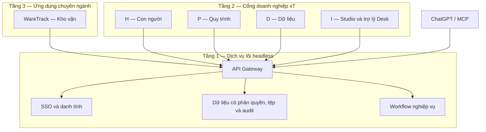

<!-- SPDX-License-Identifier: Apache-2.0 -->
<!-- SPDX-FileCopyrightText: 2026 xT contributors -->

# Kế hoạch thống nhất xT, Studio và WareTrack

- Ngày lập: 17/10/2026.
- Trạng thái: **đang thực thi theo yêu cầu tiếp theo của chủ dự án**.
- Phạm vi hiện tại: triển khai và kiểm thử local; chưa triển khai public. Xem [nhật ký thực thi](unified-execution.md).
- Kho mã đích: `/home/chinhan/xT`.
- Mục tiêu: một nền tảng doanh nghiệp nguồn mở, kiến trúc ba tầng, ánh xạ bảy lớp, có đủ bốn không gian H/P/D/I.

## 1. Căn cứ và kết quả khảo sát

Tài liệu gốc: `/home/chinhan/Downloads/Slide_Bao_Cao_DX_OS_OLP_2026.html` và bản đề thi lưu nội bộ `research/de_thi_OLP2026.txt`. Slide trình bày chung lớp 5–6; kế hoạch tách hai lớp theo bảng trong đề thi. Không đưa tài liệu đề thi bị hạn chế phát hành vào gói nguồn công khai.

Đề thi yêu cầu tối thiểu bốn dịch vụ tầng 1 và ít nhất một không gian tầng 2. Phạm vi cả H/P/D/I cùng WareTrack tầng 3 là yêu cầu mở rộng của chủ dự án. Bảy lớp là khung tham chiếu chức năng, không bắt buộc triển khai bảy sản phẩm riêng.

Tài liệu kỹ thuật liên quan: [kiến trúc xT](../architecture-v2.md), [danh tính](../identity.md), [dữ liệu headless](../headless-data.md), [workflow](../workflow-api.md), [hợp đồng công cụ](../tool-contracts-v1.md), [Studio](../../imports/dify-rea/README.md).

| Thành phần | Đã quan sát trong mã nguồn | Khoảng trống khi hợp nhất |
|---|---|---|
| xT Core | Keycloak, APISIX, PostgreSQL/RLS, object storage, Model Engine, workflow, audit, MCP | Chưa có gói nghiệp vụ kho; cần hợp đồng phục vụ cổng doanh nghiệp và Studio |
| xT Desk | OIDC, phiên người dùng, chat, MCP và giao diện công cụ | Chưa có đầy đủ màn hình doanh nghiệp H/P/D/I |
| Studio tại `imports/dify-rea` | Chat, workflow AI, RAG, agent, model, MCP connector, SQLite và đăng nhập riêng | Chưa có SSO xT, phân quyền nhiều thành viên/doanh nghiệp hoặc kết nối MCP xT theo người dùng |
| WareTrack tại `imports/waretrack-3d` | Giao diện kho và mô phỏng 3D bằng Three.js; thay thế bản WareTrack cũ theo yêu cầu chủ dự án | Chưa có backend nghiệp vụ, xác thực hoặc lưu tồn kho thật trong module 3D |

Studio là bản dựng tham khảo chức năng Dify, không phải toàn bộ mã nguồn Dify và chưa được chứng minh tương đương toàn bộ hành vi Dify. Kế hoạch giữ các chức năng đang có, không lấy tên Dify làm bằng chứng đã đủ tính năng.

Trước kế hoạch này chỉ có khảo sát và cài dependency cho hai bản sao; chưa sửa mã để hợp nhất. Kết quả kiểm thử độc lập trước đây không thay thế kiểm thử tích hợp mới.

## 2. Định hướng sản phẩm và phạm vi

### 2.1 Sản phẩm người dùng nhìn thấy

- Một cổng web xT: đăng nhập, chọn doanh nghiệp được tham gia, mở H/P/D/I hoặc WareTrack.
- Nhân viên xem việc, tài liệu, tạo yêu cầu và thao tác kho trong quyền được cấp.
- Quản lý quản trị thành viên, duyệt yêu cầu, xem báo cáo và lịch sử nghiệp vụ.
- Người xây dựng AI dùng Studio trong không gian I; model local là một lựa chọn cấu hình, không là điều kiện bắt buộc cho toàn bộ cổng web.
- ChatGPT tiếp tục là kênh thao tác qua MCP với cùng danh tính, quyền, dữ liệu và quy trình.
- Bình Minh là doanh nghiệp demo được tạo bằng seed; nền tảng không cố định tên công ty, tài khoản hay hàng hóa trong logic.

### 2.2 Bản tích hợp đầu tiên phải có

SSO và phân tách doanh nghiệp; bốn không gian có chức năng thật; Studio giữ chat/workflow/RAG/agent/model; WareTrack có nhập/xuất kho được phê duyệt và lưu bền; báo cáo dùng dữ liệu chung; AI đọc đúng quyền và đề xuất nghiệp vụ qua lõi; một bộ triển khai, tài liệu và kiểm thử liên thông.

Chưa đưa vào bản đầu: ERP/TMS đầy đủ, thanh toán thuê bao, marketplace, sao chép toàn bộ Dify, dự báo ML khi chưa có dữ liệu, IoT thật khi chưa có thiết bị và vận hành HA nhiều vùng. Giữ các khả năng đã tồn tại của dự án; ghi rõ trạng thái hỗ trợ trong chế độ tích hợp.

## 3. Kiến trúc ba tầng và bảy lớp

Tầng 1 không chứa giao diện nhân viên. Màn hình quản trị doanh nghiệp thuộc H/P/D ở tầng 2. Studio là công cụ xây dựng AI thuộc I; ứng dụng AI chuyên ngành được tạo từ Studio có thể phục vụ tầng 3.

| Lớp tham chiếu | Phương án tận dụng và bổ sung | Bằng chứng nghiệm thu |
|---|---|---|
| 1. Trải nghiệm và giao diện đa kênh | Cổng xT, Studio, WareTrack, ChatGPT/MCP | Cùng hồ sơ nghiệp vụ có thể truy cập qua web và MCP theo quyền |
| 2. Biên mạng, cửa ngõ và ATTT | Keycloak, APISIX, xác thực và phân quyền xT | Kiểm thử đăng nhập, hết hạn, thu hồi, đổi doanh nghiệp, truy cập chéo bị từ chối |
| 3. Tác nghiệp, logic và trạng thái thực thể | Model Engine, PostgreSQL; danh mục kho và phiếu | Ràng buộc dữ liệu, trạng thái hợp lệ, xử lý xung đột cập nhật |
| 4. Tự động hóa, quy trình và DevSecOps | Workflow xT, workflow AI, worker, build/test hiện có | Duyệt đúng vai trò, xử lý lỗi/retry, build và phục hồi cấu hình tái hiện được |
| 5. Hội tụ dữ liệu, truyền phát và sổ cái | Giao dịch kho, sự kiện/outbox theo cơ chế hiện có, tệp và audit | Sự kiện không ghi trùng, đối soát tồn kho, lưu được nguồn và thời điểm phát sinh |
| 6. Phân tích, không gian và trí tuệ | Báo cáo, sơ đồ kho, RAG và model | Số liệu đối soát được; AI trích nguồn; sơ đồ phản ánh đúng loại dữ liệu |
| 7. Quản trị, tìm kiếm và giám sát | Audit, tìm kiếm, danh mục nguồn dữ liệu, log và health | Truy ngược actor → phiếu → giao dịch → báo cáo; tìm lỗi theo mã yêu cầu |

Một dịch vụ có thể phục vụ nhiều lớp. Không cài thêm một công nghệ chỉ để đủ bảy tên. Audit có hash-chain không tự chứng minh khả năng lưu trữ bất biến hay HA; chỉ ghi nhận đặc tính đã kiểm thử.

## 4. Quyền sở hữu dữ liệu và ranh giới xử lý

| Loại dữ liệu/chức năng | Nơi chịu trách nhiệm |
|---|---|
| Đăng nhập, phiên định danh | Keycloak và lớp xác minh danh tính xT |
| Doanh nghiệp, nhân sự, phòng ban, quyền nghiệp vụ | xT; vai trò nghiệp vụ lấy từ dữ liệu xT |
| Kho, vị trí, hàng hóa, phiếu, biến động tồn | xT Core/PostgreSQL |
| Phê duyệt, SLA, quyền thực hiện chuyển trạng thái | Workflow và IAM xT |
| Định nghĩa ứng dụng AI, đồ thị AI, cấu hình model, lịch sử chạy | Studio, ràng buộc doanh nghiệp và quyền thành viên xT |
| Tài liệu nghiệp vụ gốc | Kho tài liệu xT; chỉ mục RAG là dữ liệu dẫn xuất có nguồn và phiên bản |
| Vị trí camera, lựa chọn hiển thị, trạng thái hoạt cảnh | Frontend WareTrack |

Nguyên tắc thực thi:

1. Doanh nghiệp của yêu cầu lấy từ ngữ cảnh đã xác minh, không tin `tenant_id` do trình duyệt tự gửi.
2. Không đưa token cố định của quản trị viên vào Studio/WareTrack. Lời gọi phải gắn với người dùng hoặc service identity có phạm vi rõ ràng.
3. Ưu tiên tái sử dụng MCP/tool contracts cho nghiệp vụ đã có. Nếu cần HTTP adapter cho UI, adapter gọi cùng application service và chính sách; không tạo đường ghi bỏ qua workflow.
4. `/data` hiện là đường đọc, audience riêng. Không dùng token MCP/Desk cho PostgREST khi chưa có thiết kế cấp token phù hợp, không mở quyền ghi trực tiếp để tiện tích hợp.
5. Workflow AI xử lý truy xuất, gọi model, tổng hợp. Workflow xT quyết định người duyệt, điều kiện nghiệp vụ và giao dịch được phép commit.
6. Duyệt phiếu không tự đồng nghĩa đã ghi kho. Ghi tồn kho, sổ biến động và trạng thái đã ghi nhận phải nhất quán trong transaction.
7. Giữ dữ liệu Studio hiện có; chọn tiếp tục SQLite cho cấu hình AI ở bản đầu nếu đáp ứng tenant/RBAC/backup. Chỉ chuyển database khi kiểm chứng có nhu cầu, không migrate chỉ để cùng tên hệ quản trị.
8. Khi tài liệu bị thu hồi quyền hoặc xóa, tìm kiếm và RAG phải ngừng trả nội dung cũ. Dữ liệu mô phỏng không trộn vào nguồn RAG nghiệp vụ thật.

## 5. Phạm vi chức năng H/P/D/I và WareTrack

| Không gian | Chức năng tối thiểu | Hành động nghiệm thu |
|---|---|---|
| H | Đăng nhập; doanh nghiệp, thành viên, phòng ban, vai trò; việc của tôi; tài liệu/SOP; thông báo | Thêm thành viên, gán quyền, xem đúng việc và đọc đúng tài liệu; thu hồi quyền có hiệu lực |
| P | Danh mục quy trình/SOP; yêu cầu; inbox duyệt; kiểm tra đầu vào; SLA; lịch sử | Người tạo gửi phiếu, người đúng vai trò duyệt/từ chối; dữ liệu sai bị chặn |
| D | Danh mục chuẩn; bảng dữ liệu; bộ lọc; báo cáo; nguồn dữ liệu và lịch sử | Số liệu báo cáo bằng số liệu giao dịch; mở được phiếu nguồn và audit |
| I | Studio chat/workflow/RAG/agent/model; Desk; công cụ xT theo quyền; truy vết | AI trả lời có nguồn, tạo được đề xuất và chờ duyệt khi cần |
| WareTrack | Kho/vị trí/SKU/đơn vị; phiếu nhập/xuất và dòng hàng; tồn kho; lịch sử; sơ đồ kho | Nhập/xuất qua quy trình; tải lại trang và khởi động lại dịch vụ không mất giao dịch |

Phân quyền Studio tối thiểu: quản trị cấu hình/model/credential; người biên tập ứng dụng; người dùng chạy ứng dụng được cấp. Mỗi endpoint, lịch sử chat, phiên bản, tài liệu và lần chạy đều phải kiểm tra workspace và quyền, không chỉ ẩn nút trên UI.

Public share và API key của Studio cần được rà soát riêng. Trong chế độ tích hợp, chỉ bật khi đã có phạm vi doanh nghiệp/ứng dụng, thu hồi và kiểm thử; giao diện phải thể hiện đúng trạng thái hỗ trợ.

Giao diện 3D có hai nguồn được nhận diện rõ: chế độ mô phỏng và chế độ xem dữ liệu nghiệp vụ. Vòng lặp hoạt cảnh không được sửa tồn kho server. Nếu chưa có vị trí thực tế, hiển thị là sơ đồ minh họa, không gọi là digital twin thời gian thực.

## 6. Các giai đoạn thực hiện

Mỗi giai đoạn chỉ hoàn thành khi có đầu ra và bằng chứng nghiệm thu. Không đặt lịch ngày cố định trước khi chốt hợp đồng và kiểm tra baseline.

### G0 — Chốt thiết kế và baseline

- Kiểm kê mã nguồn, thay đổi chưa commit, dữ liệu/runtime và test hiện có; xác định phần nào từ phiên trước.
- Lập ma trận chức năng đã có/cần nối/cần viết; xác nhận giấy phép mã nguồn, dependency, ảnh/font/asset của hai dự án nhập.
- Chốt vai trò, ownership dữ liệu, trạng thái phiếu, quy tắc tồn kho và hợp đồng API/MCP cần dùng.
- Mỗi hợp đồng nêu rõ endpoint/tool, input/output và lỗi, audience/client được phép, nguồn tenant/actor, pagination, revision/idempotency nếu ghi, cùng audit phát sinh.
- Chốt phương thức tích hợp UI sau khảo sát build/CSP: ưu tiên shell cùng origin và module có vòng đời riêng; nếu dùng iframe phải thiết kế bridge, logout và chính sách frame cụ thể.
- Lưu sơ đồ, quyết định kiến trúc, ma trận quyền và danh sách kiểm thử baseline.
- **Gate:** không còn mâu thuẫn về nơi lưu dữ liệu, người có quyền ghi và thời điểm tồn kho thay đổi.

### G1 — Repo, build và runtime thống nhất

- Dùng repo xT làm gốc; giữ `imports/dify-rea` và `imports/waretrack-3d`. Module 3D thay bản WareTrack cũ theo yêu cầu tiếp theo của chủ dự án, vẫn phục vụ tại `/waretrack/`.
- Thêm lệnh build/test/start cho bản tích hợp, tái sử dụng lockfile hiện tại và tách cấu hình public/secret.
- Thiết kế route, cổng, health check, volume và thứ tự khởi động; giữ nguyên stack hiện có.
- Cấu hình bản demo local; không đổi hostname công khai ở giai đoạn này.
- **Gate:** checkout sạch có thể cài và build; route tài nguyên không hỏng; khởi động/dừng không chiếm nhầm cổng hay mất dữ liệu.
- Smoke tầng 1 gọi trực tiếp bốn dịch vụ SSO, gateway, data và workflow theo hướng dẫn hiện có, độc lập với UI; lưu kết quả làm bằng chứng headless.

### G2 — Danh tính, doanh nghiệp và quyền dùng chung

- Dùng SSO xT cho cổng, Studio và WareTrack; định nghĩa phiên/chuyển doanh nghiệp/đăng xuất.
- Map workspace Studio vào tenant xT và bổ sung membership/RBAC; chế độ tích hợp không mở đăng nhập cục bộ làm đường vòng.
- Triển khai adapter backend đã chốt ở G0; xác minh quyền mỗi yêu cầu, giới hạn đường chuyển tiếp và không truyền credential dư thừa.
- Có công cụ mapping dữ liệu Studio cũ với chế độ dry-run; không tự nhận tất cả workspace cũ là Bình Minh.
- **Gate:** hai doanh nghiệp, ba vai trò, token hết hạn/thu hồi và truy cập trực tiếp backend đều có kiểm thử; không lộ dữ liệu chéo.

### G3 — Cổng doanh nghiệp H/P/D/I

- Mở rộng Desk thành shell điều hướng chung, vẫn giữ luồng chat hiện tại.
- H dùng tổ chức/thành viên/tài liệu; P dùng quy trình/inbox; D dùng catalog/tìm kiếm/báo cáo cơ bản; I mở Studio và trợ lý.
- Bổ sung trạng thái đang tải, trống, lỗi, thiếu quyền; không thay lỗi backend bằng dữ liệu demo.
- Đảm bảo bàn phím, nhãn biểu mẫu, màn hình nhỏ và điều hướng quay lại hoạt động.
- **Gate:** cả bốn không gian có hành động thật; đăng xuất xóa dữ liệu phiên khỏi các module; lỗi một module không làm mất toàn bộ shell.

### G4 — Nghiệp vụ kho và kết nối WareTrack

- Tạo gói nghiệp vụ kho trong `packages/`, tận dụng Model Engine và workflow hiện có.
- Mô hình dự kiến: kho, vị trí, SKU/đơn vị, phiếu nhập/xuất, dòng phiếu, biến động kho; tồn kho là kết quả đối soát/chiếu từ biến động.
- Chốt kiểu số lượng và độ chính xác; SKU duy nhất trong tenant; vị trí phải thuộc kho; số lượng dương; không cho xuất âm trong bản đầu.
- Phiếu hỗ trợ nháp → chờ duyệt → từ chối hoặc đã ghi nhận; nếu tách đã duyệt/chờ ghi nhận thì phải có trạng thái lỗi và retry rõ ràng.
- Ghi nhận một phiếu chỉ một lần: khóa/idempotency, kiểm tra revision, kiểm tra đủ hàng tại thời điểm commit, transaction cho trạng thái và dòng biến động.
- Sửa giao dịch đã ghi bằng nghiệp vụ đảo/điều chỉnh có audit, không âm thầm sửa/xóa lịch sử.
- Nối bảng/biểu mẫu WareTrack vào backend, giữ simulation ở chế độ riêng. Gắn số liệu thật vào 3D khi có ánh xạ vị trí hợp lệ.
- **Gate:** nhập/xuất/duyệt/từ chối chạy được; retry không nhân đôi; hai lần xuất đồng thời không vượt tồn; restart không mất giao dịch.

### G5 — Dữ liệu, báo cáo và quản trị nguồn

- Báo cáo tồn theo kho/SKU, nhập/xuất theo kỳ, phiếu chờ, hàng dưới ngưỡng; số liệu có thời điểm cập nhật và link về nguồn.
- Dùng cơ chế sự kiện/worker hiện có nếu phù hợp; bổ sung outbox khi cần phát sự kiện sau transaction, không thêm message broker theo thói quen.
- Ghi nguồn dữ liệu, thời gian nghiệp vụ/thời gian tiếp nhận, actor và quan hệ phiếu → biến động → báo cáo.
- Demo IT/OT bằng dữ liệu mô phỏng có nhãn và adapter riêng; không cho sự kiện cảm biến tự ghi tồn kho. Nguồn phần cứng thật là bước mở rộng.
- **Gate:** truy vết và đối soát được mọi chỉ số; báo cáo phân quyền đúng; nguồn demo/thật không lẫn nhau.

### G6 — Studio, AI và ChatGPT kết nối lõi

- Kết nối công cụ xT theo danh tính người dùng; giữ giới hạn tự chủ và human-in-the-loop.
- RAG truy xuất tài liệu được phép, có nguồn/phiên bản; cập nhật/xóa/thu hồi quyền được phản ánh trong kết quả truy xuất.
- Duy trì chat, workflow AI, agent và quản lý model của Studio trong chế độ tích hợp; quản lý credential theo quyền đã chốt.
- Kịch bản AI: tra tồn kho; giải thích phiếu bị từ chối; hỏi SOP; đề xuất bổ sung hàng; tạo nháp yêu cầu bằng công cụ nghiệp vụ.
- Ưu tiên kiểm thử ChatGPT theo yêu cầu hiện tại; provider khác dùng fixture giao thức và được ghi rõ chưa test live nếu chưa có điều kiện.
- **Gate:** AI không thấy dữ liệu cấm, không tự vượt bước duyệt, không bịa số khi tool lỗi; kết quả web/ChatGPT/Studio đối chiếu được.

### G7 — Nghiệm thu, vận hành và bộ bài thi

- Chạy ma trận kiểm thử ở mục 8, khắc phục lỗi chặn; thử backup/restore PostgreSQL, tệp và Studio kèm khóa mã hóa.
- Hoàn thiện log có correlation ID, health, hướng dẫn nhận biết và xử lý dịch vụ lỗi.
- Đóng gói doanh nghiệp demo độc lập với cấu hình nền tảng; thử khởi tạo doanh nghiệp thứ hai và không tự seed đè dữ liệu.
- Viết hướng dẫn cài đặt, quản trị, dùng web/ChatGPT, kiến trúc, mapping ba tầng/bảy lớp/H/P/D/I, provenance/giấy phép và giới hạn đã biết.
- Ghi bằng chứng theo source snapshot/build/config cụ thể, không chỉ HEAD khi worktree còn thay đổi.
- **Gate:** tái hiện được demo end-to-end và restore; có checklist giấy phép, README, CHANGELOG, hướng dẫn build và gói nguồn sẵn sàng review.
- Nghiệm thu này dành cho bản tích hợp/demo. Cam kết production cần đánh giá riêng về tải, quota, job bền vững, TLS/secret, giám sát, sao lưu và yêu cầu HA thực tế.
- Deploy public, commit/push/release là bước riêng theo chỉ đạo của chủ dự án; kế hoạch này không thực hiện các bước đó.

### G8 — Tầng 3: Nền tảng Kinh doanh số cắm-rút

Căn cứ đề thi (Tầng Nền tảng Kinh doanh số: ứng dụng chuyên ngành cắm-rút linh hoạt, 4 nhóm mô hình) và quyết định D-UNI-T3-1.

- Ứng dụng chuyên ngành = gói nghiệp vụ (model, quy trình, quyền) + manifest ứng dụng (nhóm, gói phụ thuộc, giao diện chung sinh từ `describe_model` hoặc module riêng `/apps/<id>/`, tool được phép).
- Cắm-rút ở lõi: cài, tắt (disable) và bật lại gói theo tenant qua cùng luồng đề xuất → duyệt → audit; tắt thì ẩn ứng dụng và chặn ghi, giữ nguyên dữ liệu; ứng dụng khác và lõi không bị ảnh hưởng.
- Cổng có trang "Nền tảng Kinh doanh số" chia 4 nhóm: Dòng chảy Hàng hóa, Thời gian & Dự án, Trải nghiệm & Thuê bao, Tài sản & Không gian; hiện ứng dụng đã cài/có thể cài; quản trị đề xuất cài/tắt.
- Mỗi nhóm có ít nhất một ứng dụng mẫu chạy được: WMS (kho-hang + WareTrack 3D), Timesheet/PSA nhẹ, CRM nhẹ, Quản lý tài sản/bảo trì với nguồn IoT mô phỏng có nhãn (sự kiện chỉ tạo phiếu, không tự ghi nghiệp vụ).
- **Gate:** cài ứng dụng → xuất hiện trên web và dùng được qua ChatGPT/MCP; tắt → biến mất, dữ liệu còn, ứng dụng khác chạy bình thường; tenant khác không bị ảnh hưởng.

## 7. Phụ thuộc và chia việc

Đường phụ thuộc chính: `G0 → G1 → G2 → G3 → G4 → G5 → G6 → G7`.

Có thể song song sau G0: thiết kế UI và model kho; sau G2: kiểm thử Studio và phát triển WareTrack. Không nối AI ghi nghiệp vụ trước khi G4 có gate giao dịch/phê duyệt.

| Vai trò | Phạm vi | Quy tắc phối hợp |
|---|---|---|
| Điều phối/tích hợp | Hợp đồng, manifest, lockfile, cấu hình chung, hợp nhất và nghiệm thu | Chỉ vai trò này sửa các tệp dùng chung |
| Agent lõi | Model kho, workflow, giao dịch, IAM, kiểm thử backend | Worktree riêng; thống nhất schema trước khi đổi API |
| Agent cổng/Studio | H/P/D/I, SSO Studio, RBAC, luồng AI | Worktree riêng; không tự mở đường dữ liệu ngoài hợp đồng |
| Agent WareTrack/kiểm thử | Adapter UI kho, tách mô phỏng, e2e và đối soát | Worktree riêng; review chéo bằng chứng của hai nhánh còn lại |

Dùng tối đa ba subagent và một điều phối theo khả năng phiên. Tác vụ đơn giản ưu tiên Sol 6 low theo yêu cầu người dùng. Quyền/IAM/giao dịch phải có review và kiểm thử độc lập với người viết. Agent chỉ đọc có thể dùng chung checkout; không có hai writer cùng worktree.

Chỉ chạy một stack nặng mỗi lần; kiểm tra tài nguyên trước khi chạy. GUI test headless/Xvfb riêng, không điều khiển desktop thật. Không chạy Docker/LLM trong giai đoạn chỉ lập kế hoạch.

## 8. Ma trận nghiệm thu bắt buộc

| Mã | Kịch bản | Kết quả cần chứng minh |
|---|---|---|
| U01 | Một người mở H/P/D/I/WareTrack | Cùng danh tính và doanh nghiệp, không đăng nhập lại độc lập |
| U02 | Đổi doanh nghiệp/đăng xuất/thu hồi quyền | Không giữ dữ liệu cũ hoặc tiếp tục thao tác bằng phiên không hợp lệ |
| U03 | Đọc/sửa ID của doanh nghiệp khác | Backend từ chối trên từng endpoint, kể cả lịch sử/RAG/Studio |
| U04 | Nhân viên và quản lý dùng P | Người tạo không tự duyệt nếu quy trình yêu cầu tách vai trò |
| U05 | Nhập/xuất hợp lệ và thiếu tồn | Ghi đúng hoặc từ chối đúng; không có giao dịch dở dang |
| U06 | Gửi lại, timeout, hai lần xuất đồng thời | Không ghi trùng, không âm kho, phản hồi xung đột rõ ràng |
| U07 | Lỗi lúc duyệt/ghi kho, restart và retry | Trạng thái nhất quán; truy vết được và xử lý tiếp được |
| U08 | Đối chiếu web, báo cáo, MCP | Cùng số liệu, phạm vi và thời điểm; mở được bản ghi nguồn |
| U09 | AI đọc SOP/tồn kho và tạo yêu cầu | Có nguồn, đúng quyền, hành động qua công cụ và bước duyệt |
| U10 | Tài liệu bị xóa/đổi quyền hoặc chứa chỉ dẫn độc hại | Không trả nội dung cấm; nội dung tài liệu không thay quyền/công cụ |
| U11 | Chạy mô phỏng 3D | Không làm đổi dữ liệu nghiệp vụ hoặc báo cáo thật |
| U12 | API/LLM lỗi, mất mạng hoặc phiên hết hạn | UI báo đúng; không thành công giả, không tự gửi lại giao dịch gây trùng |
| U13 | Backup/restore và doanh nghiệp mới | Dữ liệu/credential đọc lại được; không nhầm tenant hoặc seed đè |
| U14 | Build sạch và tài liệu cài đặt | Người khác tái hiện được; không cần cookie/token cá nhân của người phát triển |
| U15 | Cài rồi tắt một ứng dụng Tầng 3 | Ứng dụng xuất hiện/biến mất trên web và MCP; dữ liệu giữ nguyên; ứng dụng khác và tenant khác không đổi |

Kiểm thử theo thứ tự: unit cho validation/authorization/transaction logic → integration với DB/SSO thật → browser e2e → ChatGPT live. Fixture model provider không được ghi thành live provider pass.

Với model pack, tận dụng các test đang tự khám phá package: `tests/unit/model/test_spec.py` và `tests/unit/composition/test_pack_ops.py`; tiếp theo là kiểm thử PostgreSQL và dry-run cài pack. Không cài pack lên tenant đang dùng trước khi review migration/digest và sao lưu phù hợp.

## 9. Kịch bản demo chốt

1. Quản trị tạo doanh nghiệp demo, thành viên và vai trò; nhân viên đăng nhập một lần.
2. Nhân viên đọc SOP trong H, mở WareTrack và tạo phiếu xuất.
3. P kiểm tra đầu vào; quản lý xem yêu cầu và phê duyệt.
4. xT ghi nhận biến động một lần; WareTrack và D cập nhật cùng số liệu.
5. Người dùng hỏi ChatGPT/Studio về tồn kho, phiếu vừa xử lý và quy định liên quan.
6. AI trả lời có nguồn, có thể tạo nháp yêu cầu mới; người có quyền quyết định bước duyệt.
7. Mở audit để xem người tạo, người duyệt, phiên bản và giao dịch; chạy thử yêu cầu sai quyền để chứng minh rào chắn.

## 10. Theo dõi tiến độ và điểm dừng

| Giai đoạn | Trạng thái khi lập kế hoạch | Bằng chứng cần bổ sung |
|---|---|---|
| G0 | Đã khảo sát sơ bộ; chưa chốt hợp đồng chi tiết | Baseline, ADR, schema/state machine, ma trận quyền |
| G1–G7 | Chưa triển khai theo kế hoạch này | Kết quả từng gate và test tương ứng |

Mỗi lần bàn giao giai đoạn ghi: phạm vi đã đổi; dữ liệu bị tác động; test đã chạy; kết quả; nguồn/build được kiểm; giới hạn còn lại; cách quay về phiên bản trước. Migration phá hủy dữ liệu không dùng rollback giả bằng cách chỉ hạ version mã nguồn.

Điểm cần quyết định ở G0: nghiệp vụ phê duyệt cụ thể của doanh nghiệp demo; precision/đơn vị hàng hóa; cách map dữ liệu Studio cũ; hỗ trợ public share/API trong bản tích hợp. Có thể đề xuất mặc định và soạn phương án review, không tự coi chúng là yêu cầu đã chốt.

**Chủ dự án đã yêu cầu thực thi. Tiến độ và bằng chứng được ghi riêng trong nhật ký thực thi; các tiêu chí của kế hoạch giữ nguyên.**
